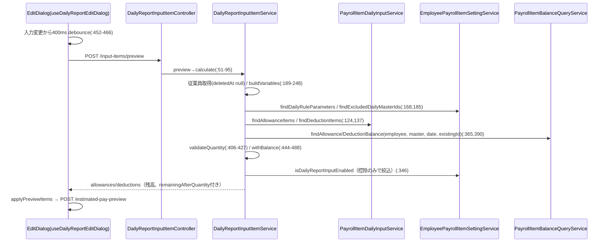
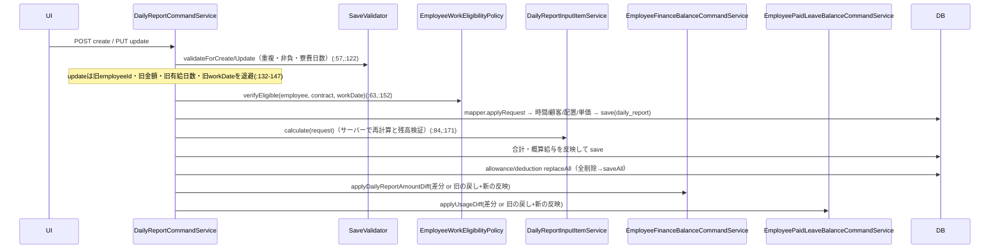
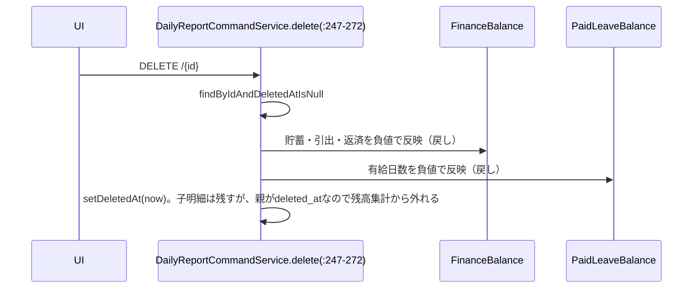
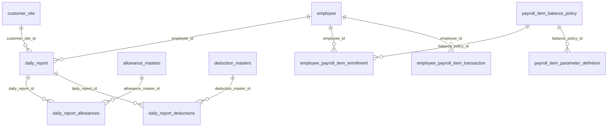
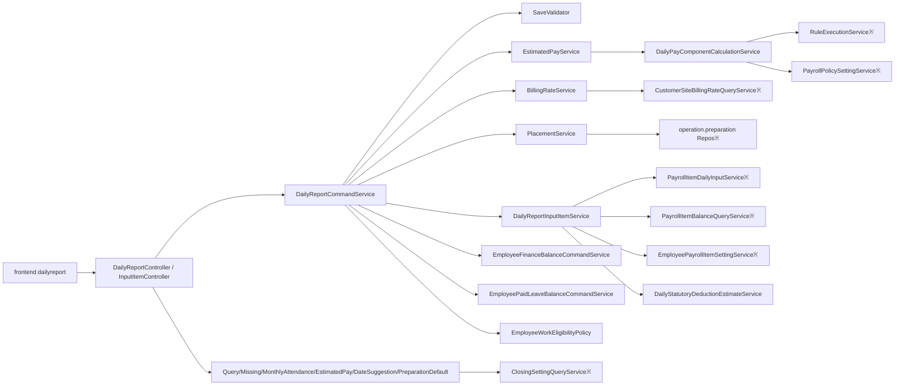

# daily-report 解析結果
- 対象: `backend/src/main/java/com/project/backend/features/dailyreport/`（以下 `BE/dailyreport`）、`backend/src/main/resources/sql/daily_report/`（8ファイル）、`frontend/src/features/dailyreport/`
- 参照仕様書: `docs/specs/daily-report/README.md`、`daily-report-screen-to-db-flow-v1.md`（未コミット差分あり。差分は「標準労働時間→週所定労働時間」の1行だけ）、`daily-report-field-usage-and-integration-v1.md`、`daily-report-unused-and-unintegrated-v1.md`、`docs/kb/daily-report-dynamic-payroll-items-rule-v1.md`（差分は上と同じ1行）、`docs/kb/payroll-item-transaction-deduction-foundation.md`（日報に関係する節だけ）
- 解析日: 2026-11-15（作業ツリー基準）
- 解析方法: Claude Code の読み取り専用サブエージェントによる静的解析。範囲外モジュールは名前のみ記録し、未検証（持ち越し質問の回答に必要な範囲だけ例外的に参照）。
- 関連: [employee.md](employee.md)、[payroll.md](payroll.md)（§8 で持ち越し質問に回答）

## 1. 概要
- 日報（1従業員×1勤務日）を登録・更新・論理削除する機能です。保存時は、サーバーが勤務時間、顧客・現場、請求単価、動的な手当・控除（Ruleと残高）、給与本体4区分を計算し直して確定します。クライアントが送る合計値はそのまま使いません。
- 保存後は、貯蓄・貸付残高（`EmployeeFinanceBalanceCommandService`）と有給残（`EmployeePaidLeaveBalanceCommandService`）へ差分を反映します。給与項目の残高（寮費・携帯など）は残高テーブルを持たず、日報明細の`quantity`と取引テーブルから都度集計します。
- 画面は3タブ（一覧／未入力者／月次勤怠）と編集Dialogで構成されます。手当・控除は入力変更のたびに400ms debounceで`/input-items/preview`を呼び、Dialogへ反映します。

## 2. 構成ファイル
| 層 | ファイル | 役割 |
|---|---|---|
| Controller | `BE/dailyreport/controller/DailyReportController.java` | CRUD、missing、monthly-attendance、estimated-pay-preview、date-suggestion、preparation-defaults |
| Controller | `BE/dailyreport/controller/DailyReportInputItemController.java` | input-items の取得とpreview |
| Service | `service/DailyReportCommandService.java` | 作成・更新・削除のトランザクション。財務・有給残高への差分反映 |
| Service | `service/DailyReportInputItemService.java` | 動的手当・控除の計算、残高付加、消化数量の検証 |
| Service | `service/DailyReportSaveValidator.java` | 必須、重複（従業員×勤務日）、非負、寮費日数0〜31、休日時間の一致 |
| Service | `DailyReportQueryService` / `DailyReportAllowanceQueryService` / `DailyReportDeductionQueryService` | 一覧・詳細、明細取得 |
| Service | `DailyReportAllowanceCommandService` / `DailyReportDeductionCommandService` | 明細を全件削除して入れ直す。変更理由を検証（LEGAL_DEPOSITは理由を自動補完） |
| Service | `DailyPayComponentCalculationService` / `DailyReportEstimatedPayService` | 給与本体4区分のRule計算と概算支給額 |
| Service | `DailyReportBillingRateService` / `DailyReportCustomerSiteResolver` / `DailyReportPlacementService` | 単価、顧客・現場、配置（準備）のスナップショット |
| Service | `DailyReportMissingQueryService` / `DailyReportMonthlyAttendanceQueryService` | 未入力者、月次勤怠 |
| Service | `DailyStatutoryDeductionEstimateService` | 法定控除の月額推計（Rule変数 `predictedStatutoryDeductionTotal`） |
| Service | `DailyReportWorkTimeCalculator` / `DailyReportWorkTimePolicy` / `DailyReportDateSuggestionService` / `DailyReportPreparationDefaultService` | 時間計算、支払日の候補、準備データからの初期値 |
| Entity | `entity/DailyReport.java`、`DailyReportAllowance.java`、`DailyReportDeduction.java`、`DailyPayRuleSetting.java` | `daily_report`、`daily_report_allowances`、`daily_report_deductions`、`daily_pay_rule_setting` |
| Repository | `repository/DailyReport*Repository.java`、`DailyPayRuleSettingRepository.java` | 派生クエリ。Allowance/Deductionには native の `sumQuantity` |
| Mapper | `mapper/DailyReportMapper.java` | MapStruct。V1では承認状態を常にAPPROVEDで保存（:185-188） |
| SQL | `sql/daily_report/payroll_item_balance_foundation_v1.sql` | 残高ポリシー、enrollment、パラメーター定義のDDL、寮費・携帯の初期データ |
| SQL | `sql/daily_report/payroll_item_transaction_foundation_v1.sql` | `employee_payroll_item_transaction` のDDLと残高イベントView |
| SQL | `pay_component_rule_foundation_v1.sql`、`payroll_policy_setting_v1.sql`、`saving_withdrawal_foundation_v1.sql`、`vehicle_arrangement_foundation_v1.sql`、`legal_deposit_refund_foundation_v1.sql`、`test.sql` | daily_reportへのカラム追加、Rule初期データ、制度設定、テスト用データ |
| FE page/component | `page/DailyReportPage.vue`、`components/DailyReportEditDialog.vue`、`DailyReportPayrollItemPanel.vue`、`DailyReport*Table.vue`、`DailyReportSearchForm.vue` | 画面 |
| FE composable/utils | `useDailyReportEditDialog.ts`（preview制御）、`useDailyReportFormFields.ts`（従業員候補の絞込）、`dailyReportConverters.ts`、`dailyReportFormFactory.ts`、`dailyReportSchema.ts` | フォーム |

## 3. エンドポイント・画面
| Method | Path | Controller#method | 概要 |
|---|---|---|---|
| GET | `/api/daily-reports/date-suggestion` | DailyReportController#findDateSuggestion (:46) | 支払日の候補 |
| GET | `/api/daily-reports` | #findAll (:55) | from/to/employeeIdで絞込（from/toは両方指定が必須） |
| GET | `/api/daily-reports/preparation-defaults` | #findPreparationDefaults (:64) | 日次準備の配置から初期値 |
| GET | `/api/daily-reports/{id}` | #findDetail (:72) | 詳細と明細 |
| POST | `/api/daily-reports` | #create (:79) | 新規 |
| PUT | `/api/daily-reports/{id}` | #update (:86) | 更新・再計算 |
| DELETE | `/api/daily-reports/{id}` | #delete (:94) | 論理削除 |
| GET | `/api/daily-reports/missing` | #findMissingEmployees (:101) | 未入力者 |
| GET | `/api/daily-reports/monthly-attendance` | #findMonthlyAttendance (:108) | 月次勤怠 |
| POST | `/api/daily-reports/estimated-pay-preview` | #previewEstimatedPay (:115) | 概算給与 |
| GET | `/api/daily-reports/input-items` | DailyReportInputItemController#findItems (:22) | 従業員の文脈なしで項目一覧 |
| POST | `/api/daily-reports/input-items/preview` | #preview (:27) | 従業員・日付ごとの手当控除計算と残高 |

| フロント部品 | API |
|---|---|
| `DailyReportPage.vue` → `useDailyReportPage.ts:16` → `api/useDailyReportsQuery.ts:19` | GET `/api/daily-reports`（from/toは画面の期間指定時だけ送信。employeeIdは送らない） |
| `DailyReportPage.vue:81,85` | GET `/missing`、GET `/monthly-attendance` |
| `useDailyReportDialog.ts:19` → `useDailyReportDetailQuery.ts:19` | GET `/{id}` |
| `useDailyReportEditDialog.ts:142,412` | POST `/input-items/preview` |
| `useDailyReportEditDialog.ts:145,428` | POST `/estimated-pay-preview` |
| `useDailyReportEditDialog.ts:544,577,657` | GET `/date-suggestion`、GET `/preparation-defaults` |
| `useCreateDailyRportMutation.ts:16` / `useUpdateDailyReportMutation.ts:21` / `useDeleteDailyReportMutation.ts:12` | POST / PUT / DELETE |
| `useDailyReportInputItems.ts:35` → `useDailyReportInputItemsQuery.ts:11` | GET `/input-items`（dailyreport配下には呼び出し元がない） |

## 4. 処理フロー
### 4.1 入力候補・残高の preview

### 4.2 保存（新規・更新）

### 4.3 削除

## 5. DB操作
| テーブル | 操作 | 実装箇所 | 備考 |
|---|---|---|---|
| daily_report | C/R/U/D(論理) | `DailyReportCommandService.java:81,90,168,177,269`、`DailyReportRepository.java` | 従業員×勤務日の重複はアプリで検査するだけ（`DailyReportSaveValidator.java:22,35`） |
| daily_report_allowances | C/R/D(物理) | `DailyReportAllowanceCommandService.java:25-40` | 更新のたびに全削除して入れ直す。`sumQuantity`は親が未削除の行だけを集計 |
| daily_report_deductions | C/R/D(物理) | `DailyReportDeductionCommandService.java:28-43`、`DailyReportDeductionRepository.java:20-39` | 同上 |
| daily_pay_rule_setting | R | `DailyPayComponentCalculationService.java:143` | tenantごと。UK(tenant_id, component_type)（`pay_component_rule_foundation_v1.sql:89-90`） |
| employee / employee_contract / employee_payroll_profile | R（profileはUも） | `DailyReportCommandService.java:274-297`、`EmployeePaidLeaveBalanceCommandService` | 有給残は `paid_leave_remaining_days` を行ロックして更新 |
| employee_saving / employee_loan / 財務取引 | U/C | `EmployeeFinanceBalanceCommandService.java:61-79,124-167` | 対象は現行の積立1件、または現行・承認済みの貸付1件 |
| payroll_item_balance_policy / employee_payroll_item_enrollment / payroll_item_parameter_definition | R（外部Service経由） | `DailyReportInputItemService.java:168,185,346,365,390` | 内部は [payroll.md](payroll.md) を参照 |
| employee_payroll_item_transaction | dailyreportからの書込なし | View `vw_employee_payroll_item_balance_event`（`payroll_item_transaction_foundation_v1.sql:187-232`）で日報明細と一緒に参照 | |
| daily_preparation(_assignments/_dispatches)、customer_site、customers、billing rate | R | `DailyReportPreparationDefaultService.java:36-67`、`DailyReportPlacementService.java:23-28` | |

## 6. 依存関係

※は対象外のため名前だけ記録（中身は見ていない）: RuleExecutionService、PayrollItemDailyInputService、PayrollItemBalanceQueryService、EmployeePayrollItemSettingService、PayrollMoneyPolicy、PayrollPolicySettingService、ClosingSettingQueryService、BusinessCalendarService、CustomerSiteBillingRateQueryService、BaseEntity/TenantContext、月次締め。

## 7. 既存仕様書との乖離
| 項目 | 仕様書の記述 | 実装 | 根拠 |
|---|---|---|---|
| 未入力者の判定 | 「在籍期間…を判定せず、未削除の全従業員を基準にする」（screen-to-db §9）、「未入力者判定の対象が広すぎる」（unused §6）。一方、同じunused資料の表:120は「対応済み」としており、資料の中で記述が食い違っている | 在籍期間・契約期間で絞り込んでいる | `DailyReportMissingQueryService.java:37-45` |
| 一覧Query | 「画面Queryは引数なしで全件取得」（screen-to-db §3.1 L60） | 画面で期間を指定するとfrom/toを送る | `useDailyReportsQuery.ts:19-25`、`DailyReportPage.vue:59-73` |
| DBテーブル名 | `allowance_master`/`deduction_master`/`payroll_item_policy`/`employee_payroll_item_setting`（screen-to-db §12） | 実際の名前は `allowance_masters`/`deduction_masters`/`payroll_item_balance_policy`/`employee_payroll_item_enrollment`（+`payroll_item_parameter_definition`） | `payroll_item_balance_foundation_v1.sql:4,93,115` |
| 新規作成シーケンス | 在籍判定がない。有給残の更新がない（screen-to-db §5） | `verifyEligible`と`applyUsageDiff`を呼んでいる | `DailyReportCommandService.java:63,110-113` |
| 削除時の戻し | 戻すのは貯蓄額・借入返済額だけ（screen-to-db §8.2） | 有給日数と貯金引出額も戻す | `DailyReportCommandService.java:256-267` |
| `useDailyReportInputItems.ts` | 「動的手当・控除の画面操作」（screen-to-db §13） | dailyreport配下に呼び出し元がない。実際の画面操作はpreview mutationと`DailyReportPayrollItemPanel.vue` | `useDailyReportEditDialog.ts:142` |
| 寮費日数の移行 | 「旧日報カラムから`DORMITORY_FEE`控除明細へ数量を移す移行処理がある」（field-usage §8 L138） | SQLは `quantity = amount`、`balance_unit='AMOUNT'` に置き換えるだけで、`dormitory_charge_days` は参照していない | `payroll_item_balance_foundation_v1.sql:403-412` |
| 数量検証の範囲 | 「日数残高を追跡する項目では、入力数量が残数量を超えないこと」（field-usage L121） | 単位に関係なく、`tracked && !advanceConsumptionAllowed` なら超過を拒否する。整数チェックはDAYSのときだけ | `DailyReportInputItemService.java:414-426` |
| 計算区分 | MANUAL/FIXED/AUTOの3区分。AUTOは編集不可（KB §4） | InputModeは5種類（FIXED_WITH_OVERRIDE / AUTO_WITH_OVERRIDE を含む）。上書き時は理由が必須 | `enums/DailyReportInputMode.java`、`DailyReportAllowanceCommandService.java:61-63` |
| Rule変数 | KB §6の固定契約一覧 | KBにない `vehicleArrangementType`、`passengerCount`、`predictedStatutoryDeductionTotal`、`itemQuantity`（数量）、enrollmentのパラメーターも渡している | `DailyReportInputItemService.java:172-174,218-245` |
| 保存手順 | KB §9は「本体へ反映→手当控除計算」の順 | 本体を先にsaveしてから`calculate`し、その後もう一度save | `DailyReportCommandService.java:81-90` |
| 残高超過の検証箇所 | 「日報入力時と保存時の両方で未徴収残高を検証」（transaction KB §4 L55） | 両方とも`calculate`内の`validateQuantity`で検証している（一致）。ただしFEは`:max`属性と`hasCollectibleBalance`による入力不可だけで、超過をエラーにはしない | `DailyReportPayrollItemPanel.vue:38-44,140` |

## 8. 持ち越し質問への回答
**Q1. InputItemServiceと外部Serviceの使い方**
- 候補の表示: 項目の母集合は `PayrollItemDailyInputService.findAllowanceItems/findDeductionItems` が返します（`DailyReportInputItemService.java:124-147`）。これに次の2つを渡します。
  - 従業員別のRuleパラメーター `EmployeePayrollItemSettingService.findDailyRuleParameters`。数量は `itemQuantity` として上書きします（:159-176）。
  - 除外マスターID `findExcludedDailyMasterIds`（:178-187）。
- 控除だけは、計算後にさらに `isDailyReportInputEnabled(employeeId, masterId, workDate)` で絞り込みます（:344-349。寮費の`inputSource=TRANSACTION`等を想定）。手当にはこの絞込がありません。
- GET `/input-items`（`findItems()`）は従業員の文脈なしで呼ぶため、従業員別設定と除外は空になります（:42-49, :164-166）。
- 残高: `PayrollItemBalanceQueryService.findAllowanceBalance/findDeductionBalance(employeeId, masterId, workDate, existingId)` を呼びます（:365,:390）。`existingId` は「同じ従業員・勤務日の未削除日報」で、自分自身の消化分を除くために使います（:334-339）。
- 数量の決め方: 単位がAMOUNTなら金額をそのまま数量とし、それ以外は送信された数量を使います（:429-442）。DAYS×FIXED系では金額＝単価×数量です（:454-464）。
- 超過検証（入力時）: preview → `calculate` → `validateQuantity` で行います。負数は拒否、DAYSは整数のみ、`tracked && !advanceConsumptionAllowed` なら `quantity > remaining` を拒否します（:406-427）。
- 超過検証（保存時）: create/updateが同じ `inputItemService.calculate(request)` を再実行するので、同じ検証がかかります（`DailyReportCommandService.java:84-85,171-172`）。
- 注意点:
  - (a) 更新で勤務日や従業員を変えた場合のpreviewでは、新しいキーで既存日報を探すため `existingId=null` になります。旧日報の消化分が残高から差し引かれたまま表示・検証される可能性があります。
  - (b) 保存時は先に本体を新しいキーでsaveしてから検索するので、自分自身は除外されるはずです。ただしHibernateのAUTO flushが効くことが前提です（:168-172）。
  - (c) `validateQuantity` は控除の絞込（:346）より前に実行されます。そのため非表示になる控除でも、送信された数量があれば例外になり得ます。

**Q2. 寮費**
- `daily_report.dormitory_charge_days`: Entity（`DailyReport.java:254-255`）、Mapper（`DailyReportMapper.java:96,150-154`）、Validator（`DailyReportSaveValidator.java:62-66`）、詳細レスポンス（`DailyReportQueryService.java:396-397`）では保存・受け渡しされます。しかし計算には使われていません。`buildVariables` に含まれず（`DailyReportInputItemService.java:189-248`）、Rule変数にもなりません。
- FEでは型・schema・factory・converterに残っています（`dailyReportSchema.ts:99`、`dailyReportFormFactory.ts:78,333`、`dailyReportConverters.ts:155-157`）。components配下には参照がなく、入力欄はありません。結果として、既存値をそのまま送り返すだけの旧互換値です。
- Rule: `employee/dormitory_foundation_v1.sql` は Rule `DORMITORY_DAILY_FEE`（`dormitoryDailyAmount * itemQuantity`）を登録します（:147-151）。さらに `deduction_masters` を `calculation_type='AUTO', rule_name='DORMITORY_DAILY_FEE'` に更新します（:247-256）。
- しかし `daily_report/payroll_item_balance_foundation_v1.sql` は `DORMITORY_FEE` を `calculation_type='MANUAL', rule_name=NULL` に戻します（:434-441, 新規INSERTも:424 MANUAL）。こちらは `dormitory_fee_setting`（`dormitory_foundation_v1.sql:90` で作成）をJOINしているため、後から適用される前提です。最終状態は**MANUAL（日次の実徴収額を手入力）**と判断します。
- 残高ポリシーは `AMOUNT` 単位で、月次発生額は `CALENDAR_DAYS_TIMES_PARAMETER:dormitoryDailyAmount`（適用日数×日額）です（:458-460）。日報では金額＝消化数量になります（`DailyReportInputItemService.java:434-437`）。
- 仮にAUTO Ruleが有効だった場合、`itemQuantity`に金額が入るので結果が不整合になります。
- `dormitory_fee_setting` はSQLだけで参照されます（`payroll_item_balance_foundation_v1.sql:493,506,609-616,644-648`。選択肢の値とenrollmentへの日額スナップショット）。dailyreportのJava/FEからの参照はありません。

**Q3. 従業員系Serviceの呼び出し**
- `EmployeeWorkEligibilityPolicy.verifyEligible`: create（`DailyReportCommandService.java:63`）とupdate（:152）で呼びます。deleteでは呼びません。`isEligible` は未入力者（`DailyReportMissingQueryService.java:39`）、`overlaps` は月次勤怠（`DailyReportMonthlyAttendanceQueryService.java:81`）で使います。判定は入社日・退職日・契約開始日・契約終了日で、境界日は勤務可です（`EmployeeWorkEligibilityPolicy.java:29-54`）。
- `EmployeeFinanceBalanceCommandService.applyDailyReportAmountDiff`:
  - create: 新しい値を加算（:102-109）
  - update・同一従業員: 新旧の差分（:201-211）
  - update・従業員変更: 旧従業員へ負値（旧workDate）、新従業員へ新しい値（:216-237）
  - delete: 負値（:256-263）
- `EmployeePaidLeaveBalanceCommandService.applyUsageDiff`: 同じパターンで、create :110、update :212/:225/:238、delete :264 です。
- 戻しの正しさ（要注意点）:
  - (1) 貸付の戻し（負値）は「最新のAPPROVED貸付」に適用されます（`EmployeeFinanceBalanceCommandService.java:124-133`）。元の返済先の貸付とは限らないため、貸付が複数ある場合にずれる可能性があります。
  - (2) 貯蓄は「現在有効な積立1件」に適用されます（:61-70）。積立を無効化した後にdelete/updateすると、戻しが例外になり、日報の操作もできなくなります。
  - (3) 有給はprofileが見つからないと例外です（`EmployeePaidLeaveBalanceCommandService` の `findForUpdateByEmployeeId`）。
  - (4) 給与項目の残高（寮費等）は保存値を持たず、日報明細から都度集計します（`DailyReportDeductionRepository.java:20-31`、View `payroll_item_transaction_foundation_v1.sql:198-216` はどちらも `report.deleted_at IS NULL`）。そのため論理削除と明細の入れ直しで自動的に戻ります。
  - (5) 月次締め済み期間の編集・削除をロックする処理は、dailyreport内にはありません。

**Q4. DDLの一意制約**
- `employee_payroll_item_transaction`: `uk_employee_payroll_item_transaction_source UNIQUE (tenant_id, employee_id, target_type, target_code, source_reference)` です（`payroll_item_transaction_foundation_v1.sql:84-86`）。`deleted_at` は含みません。論理削除した後に同じ `source_reference` で再登録すると衝突します。`source_reference` はNULL可（:69）なので、NULLは何件でも重複できます。`tenant_id` はNOT NULL（:73）です。
- `employee_payroll_item_enrollment`: **UNIQUE制約はありません**。インデックス `idx_employee_balance_enrollment_period (tenant_id, employee_id, balance_policy_id, effective_from, effective_to)` だけです（`payroll_item_balance_foundation_v1.sql:105-106`）。`tenant_id` はNOT NULL（:100）、`deleted_at` はNULL可（:103）。期間が重ならないことはDBでは保証されません（初期データ投入は NOT EXISTS で重複を避けているだけ :652-659）。
- 参考: `payroll_item_balance_policy` は UK(tenant_id, target_type, target_code)（:22-23,:221）、`payroll_item_parameter_definition` は UK(tenant_id, balance_policy_id, parameter_key)（:135-136）で、どちらも `deleted_at` を含みません。`daily_report` 自体のCREATE/UNIQUEはこのフォルダにありません（ALTERのみ）。

**Q5. 論理削除された従業員・退職者**
- 論理削除された従業員: create/update/preview/input-item計算は `findByIdAndDeletedAtIsNull` で拒否します（`DailyReportCommandService.java:277-286`、`DailyReportInputItemService.java:68-72`）。未入力者・月次勤怠は `findAllByDeletedAtIsNull` で除外します（`DailyReportMissingQueryService.java:37`、`DailyReportMonthlyAttendanceQueryService.java:63`）。
- 退職者・期間外: create/updateは `verifyEligible` で拒否します。FEも勤務日を基準に従業員の選択肢を絞ります（`useDailyReportFormFields.ts:92-116`。勤務日が未入力のときだけ `activeFlag` を使う）。
- フィルタしていない箇所:
  - 一覧・詳細（`DailyReportQueryService.java:52-73,251`）は従業員の削除状態・在籍状態で絞り込みません（過去の日報はそのまま表示されます）。
  - deleteは従業員状態を確認しません。
  - 削除済み従業員の日報をupdateすると従業員取得で例外になるため、修正できません。
  - BEの判定は `activeFlag` を見ていません。

## 9. 未解決の疑問・要確認事項
1. SQLの適用順序（`runtime-schema-manifest.txt` は対象外で未確認）: `dormitory_foundation_v1.sql` が `payroll_item_balance_foundation_v1.sql` より後に再適用されると、寮費がAUTO（`DORMITORY_DAILY_FEE`）に戻ります。その場合、AMOUNT単位の`itemQuantity`（＝金額）と掛け合わせて不整合になります。
2. 更新時に勤務日・従業員を変えた場合のpreviewで、旧日報の消化分が二重に差し引かれる可能性があります（Q1の注意点(a)）。`PayrollItemBalanceQueryService` が集計期間をどう決めるかは対象外のため未確認です。
3. `enrichBalances` で控除の絞込（`isDailyReportInputEnabled`）が検証より後にあるため、非表示の控除への送信値で例外になる可能性があります。また手当側に同じ絞込がない理由は不明です。
4. 貸付の戻し先（最新のAPPROVED貸付）と、元の返済先が違う場合の扱い（Q3の(1)）。
5. 月次締め済み期間の日報を更新・削除したときのロックや再締めの連動は、dailyreportに実装がありません。月次締め側（対象外）で制御しているか確認が必要です。
6. テナント分離: `DailyReportRepository` の派生クエリにtenant条件はなく、BaseEntityまたはHibernate Filter（対象外）に依存していると推定しています。
7. `daily_report` の(employee_id, work_date)の一意性はアプリ側の検査だけです。DBに部分一意制約（未削除行のみ）があるかは、このフォルダでは確認できません。
8. `employee_payroll_item_transaction` のUKに `deleted_at` が含まれないため、論理削除後に同じ明細番号で再登録すると失敗します。仕様（transaction KB §7「指定時は重複を防止」）として意図したものかの確認が必要です。
9. `dormitory_charge_days` カラムとValidatorの0〜31チェックは計算に使われていません。廃止の時期と、`chk_daily_report_dormitory_charge_days`（`dormitory_foundation_v1.sql:83`）の扱いを決める必要があります。
