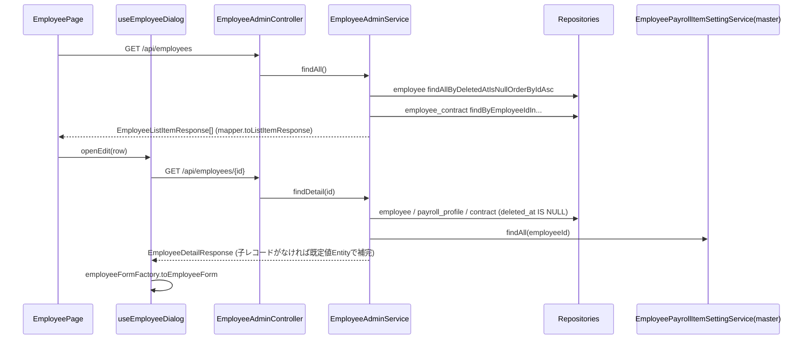
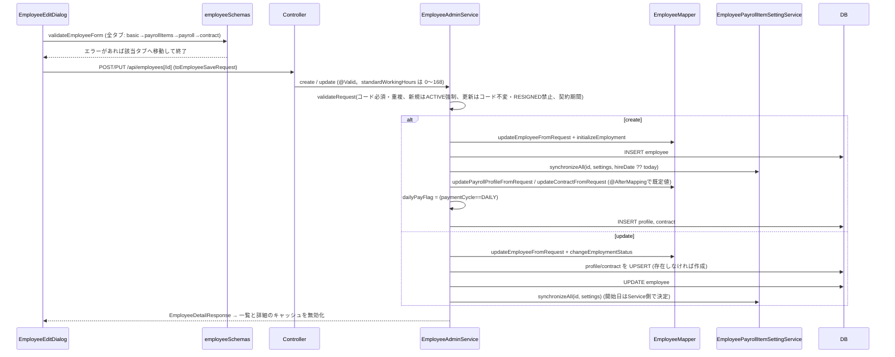
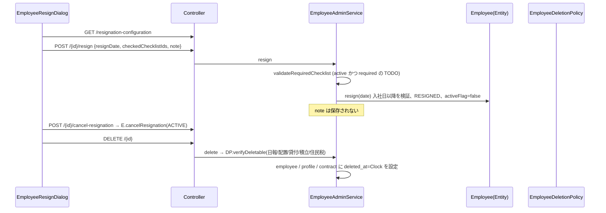
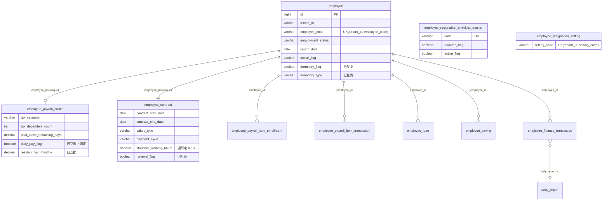
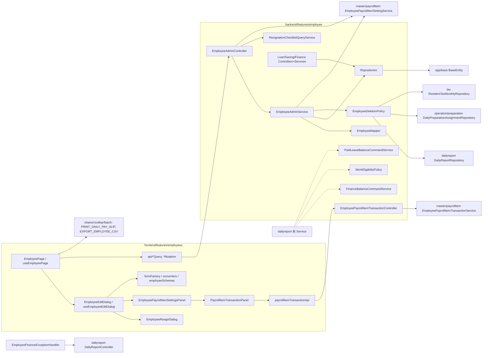

# employee 解析結果
- 対象: `backend/src/main/java/com/project/backend/features/employee/`（controller / dto / entity / enums / mapper / repository / service）、`backend/src/main/resources/sql/employee/`（business_settings_v1 / dormitory_foundation_v1 / finance_foundation_v1 / test1 / test2）、`frontend/src/features/employees/`
  - 補足: `backend/src/main/resources` 配下に employee 用の MyBatis mapper XML はなかった（`*mployee*` で検索）。ヒットした `sql/system/report/employee/employee_csv_foundation_v1.sql` は差分確認のため一部だけ読んだ。
- 参照仕様書: `docs/specs/employee/README.md`、`employee-management-screen-to-db-flow-v1.md`、`employee-field-usage-and-integration-v1.md`、`employee-standard-remuneration-editor-v1.md`、`employee-unused-and-unintegrated-v1.md`、`docs/kb/employee-management-v1-refactoring.md`、`docs/kb/employee-business-settings-foundation.md`、`docs/kb/employee-dormitory-deduction-foundation.md`
- 解析日: 2026-11-15（作業ツリー基準。未コミット変更あり: EmployeeContractSaveRequest / EmployeeListItemResponse / EmployeeMapper / useEmployeeEditDialog / useEmployeeTableConfig / employeeApiTypes / employeeSchemas / employee_csv_foundation_v1.sql）
- 解析方法: Claude Code の読み取り専用サブエージェントによる静的解析。範囲外モジュールは名前のみ記録し、未検証。

## 1. 概要
- 従業員情報画面 `/employee/information` を扱う。1つの Dialog に4タブ（基本・手当控除・給与税金・契約）があり、`employee` / `employee_payroll_profile` / `employee_contract` を1トランザクションで保存する。従業員別の手当・控除は `master/payrollitem` の EmployeePayrollItemSettingService に任せている。
- 退職と退職取消は専用 API で行う。退職時の必須 TODO は `employee_resignation_checklist_master` で検証する。削除は論理削除で、事前に参照チェック（DeletionPolicy）を通す。
- 同じ feature に、貸付・積立（`/api/employee/loans`・`/api/employee/savings`）、資金取引履歴、日報から呼ばれる残高更新サービス、勤務可否 Policy、有給残の減算サービスも同居している。
- 作業ツリーでの変更: 一覧に住所・生年月日・現在年齢を追加。「標準労働時間」を「週所定労働時間」に改名し、0〜168 の上限検証を追加。

## 2. 構成ファイル
| 層 | ファイル | 役割 |
|---|---|---|
| Controller | `controller/EmployeeAdminController.java` | 従業員の CRUD、退職・退職取消、退職設定、手当控除カタログ |
| Controller | `controller/EmployeeContractController.java` | `GET /api/employees/{id}/contract`（契約の単独取得） |
| Controller | `controller/EmployeePayrollItemTransactionController.java` | 給与項目取引の CRUD（処理は master/payrollitem に委譲） |
| Controller | `controller/EmployeeLoanController.java` / `EmployeeSavingController.java` / `EmployeeFinanceController.java` / `EmployeeFinanceTransactionController.java` | 貸付・積立 CRUD、資金サマリ、取引履歴 |
| Controller | `controller/EmployeeFinanceExceptionHandler.java` | Loan / Saving / Finance / DailyReport の IllegalArgumentException を 400 に変換 |
| Service | `service/EmployeeAdminService.java` | 保存トランザクション、業務検証、daily_pay_flag の同期 |
| Service | `service/EmployeeDeletionPolicy.java` | 削除前の参照チェック |
| Service | `service/EmployeeResignationChecklistQueryService.java` | 退職 TODO と文言の取得 |
| Service | `service/EmployeeContractQueryService.java` | 契約の単独照会 |
| Service | `service/EmployeeWorkEligibilityPolicy.java` | 在籍期間・契約期間による勤務可否判定（日報側で使用） |
| Service | `service/EmployeePaidLeaveBalanceCommandService.java` | 日報の有給使用差分を有給残から減算（悲観ロック） |
| Service | `service/EmployeeLoanService.java` / `EmployeeSavingService.java` / `EmployeeFinanceBalanceCommandService.java` / `EmployeeFinanceTransactionService.java` / `EmployeeFinanceQueryService.java` | 貸付・積立、日報連動の残高更新、取引記録、サマリ |
| Mapper | `mapper/EmployeeMapper.java`（MapStruct）、`EmployeeLoanMapper` / `EmployeeSavingMapper` | Entity と DTO の変換、null 時の既定値補完 |
| Entity | `Employee` / `EmployeeContract` / `EmployeePayrollProfile` / `EmployeeLoan` / `EmployeeSaving` / `EmployeeFinanceTransaction` / `EmployeeResignationSetting` / `EmployeeResignationChecklistMaster` | JPA。共通基底は app/base BaseEntity |
| DTO | `EmployeeSaveRequest` / `EmployeePayrollProfileSaveRequest` / `EmployeeContractSaveRequest` / `EmployeePayrollItemSettingRequest` / `EmployeeResignRequest` | 保存・退職のリクエスト（Bean Validation 付き） |
| DTO | `EmployeeListItemResponse` / `EmployeeDetailResponse` / `EmployeePayrollProfileResponse` / `EmployeeContractResponse` / `EmployeeContractQueryResponse` / `EmployeePayrollItemSettingResponse` / `PayrollItemParameter*Response` / `EmployeeResignation*Response` / Loan・Saving・Finance 系 | レスポンス |
| Enum | `EmploymentType` / `EmploymentStatus` / `Gender` / `SalaryType` / `PaymentCycle` / `TaxCategory` / `DormitoryType`（旧互換）/ `ApprovalStatus` / `EmployeeFinance*Type` | 区分値 |
| Repository | `EmployeeRepository` / `EmployeeContractRepository` / `EmployeePayrollProfileRepository` / `EmployeeResignation{Checklist,Setting}Repository` / `EmployeeLoan,Saving,FinanceTransactionRepository` | Spring Data JPA の派生クエリと `@Query` 1件 |
| SQL | `sql/employee/business_settings_v1.sql` | closing_setting 初期値、employee_resignation_setting の作成と初期値、TODO コード一意化、締め帳票の初期値 |
| SQL | `sql/employee/dormitory_foundation_v1.sql` | 旧寮列・CHECK 制約、`daily_report.dormitory_charge_days`、`dormitory_fee_setting`、Rule `DORMITORY_DAILY_FEE`、deduction_masters の更新 |
| SQL | `sql/employee/finance_foundation_v1.sql` | loan / saving の承認値補正、`employee_finance_transaction` の作成と初期取引 |
| SQL | `sql/employee/test1.sql` / `test2.sql` | テストデータ（employee / profile / contract / timesheet / loan / saving） |
| Front Page | `pages/EmployeePage.vue` / `composables/useEmployeePage.ts` / `useEmployeeDialog.ts` / `useEmployeeTableConfig.ts` / `components/EmployeeTable.vue` | 一覧、Toolbar（新規作成・帳票・CSV）、行クリックで詳細 |
| Front Dialog | `components/EmployeeEditDialog.vue` / `composables/useEmployeeEditDialog.ts` | 4タブの編集、保存・削除・退職・退職取消 |
| Front Dialog | `components/EmployeeResignDialog.vue` / `composables/useEmployeeResignDialog.ts` | 退職日、TODO チェック、メモ |
| Front Panel | `components/EmployeePayrollItemSettingsPanel.vue` / `EmployeePayrollItemParameterField.vue` / `PayrollItemTransactionPanel.vue` | 動的な手当控除設定、残高表示、取引明細 CRUD |
| Front Util | `utils/employeeFormFactory.ts` / `employeeConverters.ts` / `validation/employeeSchemas.ts` / `types/*.ts` | Form と API の変換、zod による検証、型定義 |
| Front (別画面) | `pages/EmployeeLoanSavingsPage.vue` と Loan / Saving / FinanceTransaction 系の components・composables・api | 貸付・積立画面 `/employee/loan-savings` |

## 3. エンドポイント・画面
| Method | Path | Controller#method | 概要 |
|---|---|---|---|
| GET | `/api/employees` | EmployeeAdminController#findAll (:35) | 一覧。employee と contract を取得し、契約期間・住所も返す |
| GET | `/api/employees/{id}` | #findDetail (:40) | 詳細（profile / contract / payrollItemSettings を含む） |
| GET | `/api/employees/payroll-item-settings/catalog` | #findPayrollItemSettingCatalog (:30) | 新規登録用の動的設定カタログ |
| GET | `/api/employees/resignation-checklist` | #findResignationChecklist (:45) | 有効な TODO 一覧（フロントからの呼び出しなし） |
| GET | `/api/employees/resignation-configuration` | #findResignationConfiguration (:50) | 退職文言と TODO |
| POST | `/api/employees` | #create (:55) | 新規登録 |
| PUT | `/api/employees/{id}` | #update (:60) | 通常更新 |
| POST | `/api/employees/{id}/resign` | #resign (:68) | 退職 |
| POST | `/api/employees/{id}/cancel-resignation` | #cancelResignation (:81) | 退職取消 |
| DELETE | `/api/employees/{id}` | #delete (:76) | 論理削除 |
| GET | `/api/employees/{employeeId}/contract` | EmployeeContractController#findByEmployeeId (:18) | 契約の単独取得 |
| GET/POST/PUT/DELETE | `/api/employees/{employeeId}/payroll-item-transactions[/{transactionId}]` | EmployeePayrollItemTransactionController (:30-63) | 給与項目取引（GET はクエリ targetType・targetCode・targetMonth が必須） |
| GET | `/api/employees/{employeeId}/finance-summary` | EmployeeFinanceController#findSummary (:17) | 貸付・積立のサマリ |
| GET/POST/PUT/DELETE | `/api/employee/loans[/{id}]` | EmployeeLoanController | 貸付 CRUD |
| GET/POST/PUT/DELETE | `/api/employee/savings[/{id}]` | EmployeeSavingController | 積立 CRUD |
| GET | `/api/employee/finance-transactions` | EmployeeFinanceTransactionController | 取引履歴（任意クエリ employeeId・accountType） |

**フロントの画面・ダイアログと API 呼び出しの対応**
| 画面 / 部品 | 呼び出し（frontend 側の根拠） | API |
|---|---|---|
| EmployeePage 一覧 | useEmployeesQuery (api/useEmployeesQuery.ts:11) | GET /api/employees |
| 行クリック → EmployeeEditDialog | useEmployeeDialog → useEmployeeDetailQuery (:14) | GET /api/employees/{id} |
| EmployeeEditDialog（新規時） | useEmployeePayrollItemSettingCatalogQuery (:10)、カタログを form に設定（EmployeeEditDialog.vue:82-95） | GET …/payroll-item-settings/catalog |
| 保存ボタン | useEmployeePage.save (:39-49) → Create / Update Mutation | POST /api/employees、PUT /api/employees/{id} |
| 削除ボタン | useEmployeePage.remove (:51-62、window.confirm を使用) | DELETE /api/employees/{id} |
| 退職ボタン → EmployeeResignDialog | useEmployeeResignationChecklistQuery (:12)、useResignEmployeeMutation (:21) | GET …/resignation-configuration、POST …/{id}/resign |
| 退職取消ボタン | EmployeeEditDialog.vue:58-64（window.confirm を使用） | POST …/{id}/cancel-resignation |
| 手当控除タブ → PayrollItemTransactionPanel | payrollItemTransactionApi.ts:7-42（TanStack を通さず直接呼び出し） | /api/employees/{id}/payroll-item-transactions |
| Toolbar「支払明細書」「従業員CSV出力」 | useEmployeePage.ts:74-112（jobCode は PRINT_DAILY_PAY_SLIP / EXPORT_EMPLOYEE_CSV） | 共通バッチ基盤（範囲外） |
| EmployeeLoanSavingsPage | Loan / Saving / FinanceSummary / FinanceTransactions の各 Query・Mutation | /api/employee/loans、/api/employee/savings、/api/employee/finance-transactions、/api/employees/{id}/finance-summary |
| （employees 内に利用箇所なし） | useEmployeeContractQuery (:19) | GET /api/employees/{id}/contract（他 feature から使われている可能性あり。要確認） |

## 4. 処理フロー
### 4.1 一覧・詳細

### 4.2 保存（新規・更新）

### 4.3 退職・退職取消・削除

## 5. DB操作
| テーブル | 操作 | 実装箇所 | 備考 |
|---|---|---|---|
| employee | C/R/U/D(論理) | EmployeeAdminService.java:48,68,90,147,168,185,205 | 一意制約は `(tenant_id, employee_code)`（Employee.java:16-21）。旧寮列 dormitory_flag / dormitory_type は更新しない |
| employee_payroll_profile | C/R/U/D(論理) | EmployeeAdminService.java:71,108,144,207 / EmployeePaidLeaveBalanceCommandService.java:27-40 | 有給残は PESSIMISTIC_WRITE で取得（EmployeePayrollProfileRepository.java:18-27）。daily_pay_flag は同期のみ |
| employee_contract | C/R/U/D(論理) | EmployeeAdminService.java:49,74,109,145,210 / EmployeeContractQueryService.java:28 | 1:1（employee_id は unique）。renewal_flag は request が null のときだけ false を設定 |
| employee_payroll_item_enrollment | C/R/U | EmployeePayrollItemSettingService.synchronizeAll / findAll（master 側・範囲外） | 従業員削除時に deleted_at を設定していない |
| employee_payroll_item_transaction | C/R/U/D | EmployeePayrollItemTransactionService（master 側・範囲外） | 呼び出し元は EmployeePayrollItemTransactionController |
| employee_resignation_checklist_master | R | EmployeeAdminService.java:351-353 / QueryService:27-28 | 更新は管理者の業務設定側（範囲外） |
| employee_resignation_setting | R | EmployeeResignationChecklistQueryService.java:35-39 | setting_code が DEFAULT の行。なければ Entity の既定値 |
| employee_loan / employee_saving | C/R/U/D(論理) | EmployeeLoanService / EmployeeSavingService / EmployeeFinanceBalanceCommandService | 有効な設定は従業員ごとに1件まで |
| employee_finance_transaction | C/R | EmployeeFinanceTransactionService.java:26-54,58 | 貸付・積立の残高変動履歴 |
| daily_report / daily_preparation_assignment / resident_tax_monthly | R(exists) | EmployeeDeletionPolicy.java:24-38 | 削除前の参照チェック |
| dormitory_fee_setting / rule_master / rule_parameter / deduction_masters / daily_report(列追加) | DDL / C / U | dormitory_foundation_v1.sql:90-257 | 移行 SQL（Java からの参照はない） |
| closing_setting / monthly_closing_output_definition | C | business_settings_v1.sql:6,158 | 移行 SQL |

## 6. 依存関係

（点線: 日報系からの利用は推定で、範囲外のため未確認。frontend の利用元として `app/menu/employeeMenu`、`features/dailyreport/*`、`features/operation/preparation/*`、`features/admin/business/*` がファイル名レベルで employees を参照している）

## 7. 既存仕様書との乖離
| 項目 | 仕様書の記述 | 実装 | 根拠 path:line |
|---|---|---|---|
| 一覧取得の参照テーブル | flow-v1 §3.1: `employee` だけを ID 昇順で取得 | `employee_contract` も一括取得し、契約開始・終了日と住所（作業ツリーで追加）を返す | backend/.../service/EmployeeAdminService.java:49-62、dto/EmployeeListItemResponse.java:25-27、mapper/EmployeeMapper.java:28-31 |
| 新規登録の処理順 | flow-v1 §4: employee → profile → contract → enrollment 同期 | employee INSERT の直後に enrollment を同期し、その後 profile / contract を保存 | EmployeeAdminService.java:90-109 |
| 新規時の enrollment 開始日 | flow-v1 §4、unused §5: 新規は入社日 | 入社日が null なら `LocalDate.now(clock)` | EmployeeAdminService.java:91-93 |
| 画面 API 一覧 | flow-v1 §9 に `/contract`、`/payroll-item-transactions`、`/finance-summary` の記載がない | 従業員画面の手当控除タブから payroll-item-transactions の CRUD を呼んでいる | frontend/.../components/EmployeePayrollItemSettingsPanel.vue:168-、api/payrollItemTransactionApi.ts:7-42、controller/EmployeePayrollItemTransactionController.java:24 |
| 退職 TODO API | flow-v1 §9: `/resignation-checklist` を退職 TODO として使用 | フロントは `/resignation-configuration` だけを呼ぶ。`/resignation-checklist` は未使用 | frontend/.../api/useEmployeeResignationChecklistQuery.ts:12、EmployeeAdminController.java:45-48 |
| Toolbar の取込 | flow-v1 §11: useEmployeePage は「一覧CRUD・CSV・帳票・取込Toolbar」。field-usage §6 と KB §8 は取込を V1 対象外とする | 取込ボタンはない。仕様書同士でも食い違っている | frontend/.../composables/useEmployeePage.ts:64-113 |
| 帳票名・CSV パラメーター | field-usage §6: 「個別日次給与明細」。CSV にパラメーター記載なし | ラベルは「支払明細書」（preview）。CSV に `includeDeleted`（削除済みを含める）がある | useEmployeePage.ts:75-78,105-110 |
| 給与形態の表示名 | field-usage §4: 「給与形態」 | 画面と CSV は「給与計算基準」 | composables/useEmployeeEditDialog.ts:173、employee_csv_foundation_v1.sql:306 |
| 税区分の選択肢 | field-usage §3: 税区分は利用中（制限の記載なし） | 乙・丙は disabled で、甲しか選べない | useEmployeeEditDialog.ts:21-25 |
| 貸付・積立の API パス | KB management §2.4: `/api/employee-loans`、`/api/employee-savings` | `/api/employee/loans`、`/api/employee/savings` | controller/EmployeeLoanController.java:15、EmployeeSavingController.java:15 |
| 削除前の参照チェック | KB business-settings §3.5: 日報・翌日準備・貸付・積立・**旧勤怠**・住民税 | 旧勤怠（employee_timesheet）はチェックしていない。翌日準備のメッセージは「現場配置・配車」 | service/EmployeeDeletionPolicy.java:23-39 |
| 削除の連鎖範囲 | flow-v1 §8: employee / profile / contract に deleted_at | 記述どおり。ただし enrollment・取引は未処理で、仕様にも記載がない | EmployeeAdminService.java:204-211 |
| 社員コードの再利用 | flow-v1 §8: 再利用可否は Repository の `deleted_at IS NULL` 条件に依存 | アプリ側は削除済みを除いて重複判定するが、Entity の一意制約 `(tenant_id, employee_code)` に deleted_at が含まれない。DB 制約が同じなら再登録時に制約違反になる | Employee.java:16-21、EmployeeAdminService.java:304-310、repository/EmployeeRepository.java:16-18 |
| 旧寮列の同期 | KB dormitory §2: `employee.dormitory_flag/type` は互換用に**同期する**。unused §1.1: 新しい処理では参照・更新しない（仕様書同士が矛盾） | 同期処理はない。`updateDormitory` は移行専用で @Deprecated | entity/Employee.java:72-101、EmployeeAdminService 全体に呼び出しなし |
| 寮費の計算モデル | KB dormitory §4-5: `CALENDAR_DAYS_TIMES_PARAMETER:dormitoryDailyAmount` で残高を発生させ、日報には円で実徴収額を入力 | SQL は Rule `DORMITORY_DAILY_FEE = dormitoryDailyAmount * itemQuantity`（「寮費日額×日報の徴収日数」）を投入し、`daily_report.dormitory_charge_days`（0〜31日）を追加している | sql/employee/dormitory_foundation_v1.sql:57-88,146-174 |
| 寮費日額の管理場所 | KB business-settings §2・§7: 寮費設定は控除マスターへ統合済みで `/dormitory-fees` は廃止 | SQL は `dormitory_fee_setting` を作成して 0円で投入し、コメントは「業務設定画面で正式金額へ変更する」 | dormitory_foundation_v1.sql:90-127 |
| unused §2 の旧互換項目 | `dailyPayFlag` などは「API DTO と画面 model へ残っている」 | dailyPayFlag と dormitory* は DTO・Form から削除済み。残っているのは resignDate と activeFlag だけ | dto/EmployeeSaveRequest.java:16-34、frontend/.../utils/employeeConverters.ts:17,24 |
| unused §1.1 の CSV 旧経路 | 一部 CSV が dormitory_type をコピー | CSV の work table には旧寮列と resident_tax_monthly が残るが、最終出力の列には含まれない（field-usage §6 とは一致） | employee_csv_foundation_v1.sql:35-36,148,176-183,284-316 |
| 週所定労働時間 | standard-remuneration §週所定: 0〜168 時間、表示名「週所定労働時間」 | 一致（作業ツリーで対応）。ただし README の資料一覧にこの仕様書が載っていない | dto/EmployeeContractSaveRequest.java:23、validation/employeeSchemas.ts:54-56、useEmployeeEditDialog.ts:216-221、docs/specs/employee/README.md:9-15 |
| 標準報酬月額 Editor | standard-remuneration: 控除マスター詳細から開く、下書き・検証・確定の流れ | employee feature には実装なし（tax feature の未追跡ファイル StandardRemunerationEmployeeOption / EmployeeStandardRemuneration / Repository 側。範囲外で未検証） | — |
| 退職メモ | 仕様書に記載なし（KB business §9 で監査履歴は今後の課題） | Request に `note`（画面入力あり）があるが、Service は保存せずに捨てている | dto/EmployeeResignRequest.java:12、EmployeeAdminService.java:155-177、frontend/.../composables/useEmployeeResignDialog.ts:63-84 |
| 退職の事前状態 | KB business §3.3: 専用処理から実行 | `Employee.resign` は現在の状態を見ないため、RESIGNED の従業員に再度 resign すると退職日を上書きできる（画面ではボタンを非表示にしているだけ） | entity/Employee.java:114-126、useEmployeeEditDialog.ts:294-301 |

## 8. 未解決の疑問・要確認事項
1. DB DDL の一意制約に `deleted_at` が含まれるか。論理削除した後に同じ社員コードを再登録できるかは DDL 次第（DDL は範囲外で未確認）。
2. 例外の HTTP ステータス。「見つからない」「重複」などは `RuntimeException`、業務違反は `IllegalArgumentException` / `IllegalStateException` を投げている（EmployeeAdminService.java:69,254-361）。EmployeeFinanceExceptionHandler の対象に EmployeeAdminController は含まれないため、共通ハンドラー（範囲外）での変換結果を確認する必要がある。
3. 権限制御。Controller に `@PreAuthorize` などがなく、アクセス制御はセキュリティ設定（範囲外）に依存している。
4. `PUT` で `payrollProfile` / `contract` が null の場合、Mapper が既定値で上書きし、旧互換列（dependentFlag / residentTaxMonthly）も 0 / false に戻す（EmployeeMapper.java:84-99,140-149）。この挙動が意図どおりか。
5. `GET /api/employees/{id}/contract` と `/resignation-checklist` の利用者。employees feature 内では使われていない（日報など他 feature から使われているかは未確認）。
6. 寮費モデルを最終的にどれにするか（KB dormitory の金額入力＋残高発生、SQL の日額×日数 Rule、dormitory_fee_setting テーブルの存廃）。現行 DB で有効な Rule と、master/payrollitem 側の実装（範囲外）を確認する必要がある。
7. 削除時に `employee_payroll_item_enrollment` と `employee_payroll_item_transaction` が残るが、削除 Policy の参照チェックにも含まれていない。取引がある従業員も削除できてしまう可能性がある。
8. EmployeeEditDialog の `resigned` emit を EmployeePage が受けていない（EmployeeEditDialog.vue:25、EmployeePage.vue:30-35）。キャッシュは Mutation 側で無効化しているので実害は小さいが、意図を確認したい。
9. PayrollItemTransactionPanel の「今日」はブラウザのローカル時刻（PayrollItemTransactionPanel.vue:20-26）、useEmployeePage は Asia/Tokyo 固定（:26-27）で、扱いが揃っていない。
10. 退職取消の戻り先は常に ACTIVE（EmployeeAdminService.java:184）。退職前が LEAVE だった場合も ACTIVE になるが、これが仕様か（仕様書の記述は ACTIVE で一致）。
11. テストデータ `sql/employee/test2.sql` が、V1 で廃止された `employee_timesheet` にまだ INSERT している。
