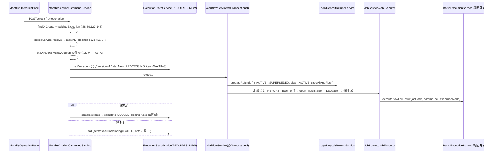
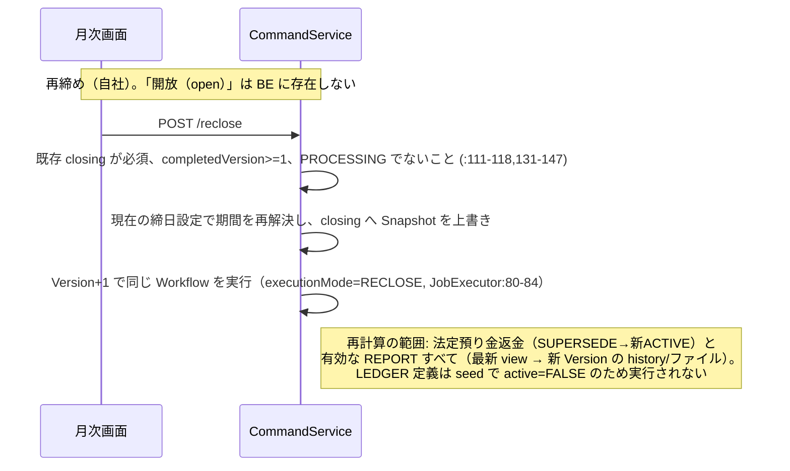
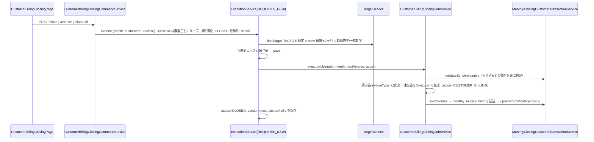
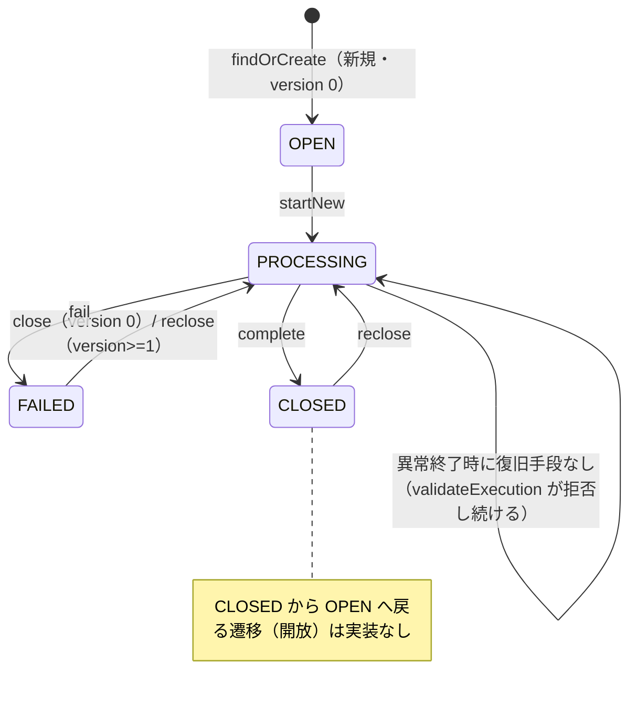
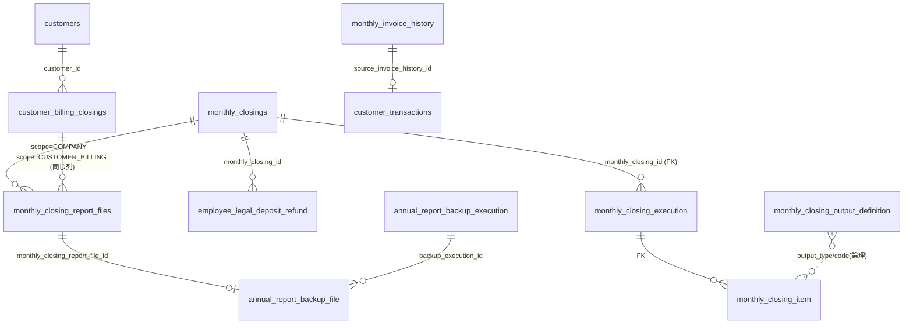
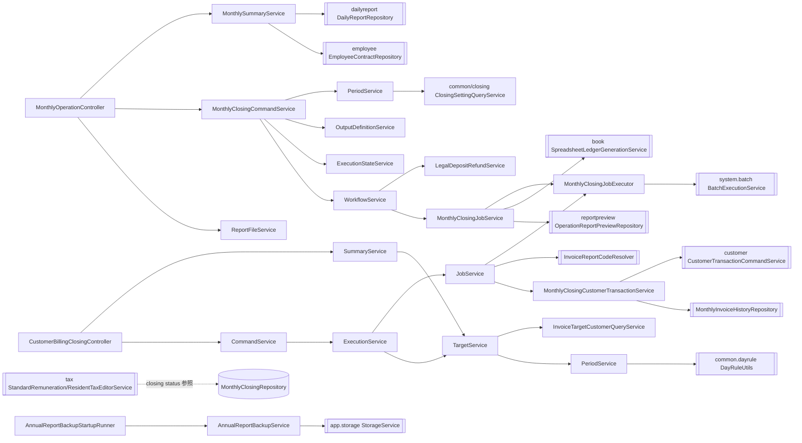

# monthly-closing 解析結果

- 対象: 自社月次締め＋顧客請求締め（operation sub-unit 1-7a）
  - `BE` = `backend/src/main/java/com/project/backend`、`SQL` = `backend/src/main/resources/sql`、`FE` = `frontend/src/features/operation`
- 参照仕様書: `docs/specs/monthly-closing/*`（README, screen-to-db-flow, field-usage, unused, monthly-pay-slip-item-flow[未コミット変更あり]）、`docs/specs/customer-billing-closing/*`、`docs/kb/monthly-closing-output-foundation.md`、`docs/kb/customer-billing-closing-order-form-v1.md`、`docs/kb/customer-transaction-v1-refactoring.md`
- 解析日: 2026-11-15（作業ツリー基準。未コミット変更も含む）
- 解析方法: Claude Code の読み取り専用サブエージェントによる静的解析。範囲外モジュールは名前のみ記録し、未検証。持ち越し質問の回答に必要な範囲だけ、給与明細 view と runtime-schema-manifest を例外的に参照。§8 Q1 の「締め状態を参照する箇所」の調査だけは、シンボル名に限定して backend Java 全体を検索した。
- 関連: [employee.md](employee.md)、[payroll.md](payroll.md)、[daily-report.md](daily-report.md)

## 1. 概要
- 自社月次締め（`/api/operation/monthly`）: 給与締日設定から対象期間を決め、Version 付きで法定預り金返金の Snapshot と月次帳票（REPORT）を確定します。状態は `monthly_closings` に、試行履歴は `monthly_closing_execution` と `monthly_closing_item` に保存します。業務処理と状態更新は別 Transaction です。
- 顧客請求締め（`/api/operation/customer-billing`）: 顧客ごとの締日から請求期間を決め、請求書・注文書を生成し、確定請求履歴を顧客取引へ upsert します。顧客1社ごとに `REQUIRES_NEW` の Transaction で実行します。
- 締め済み期間のロック（日報・取引などの編集禁止）は、この範囲のどこにも実装されていません（§8 Q1）。
- 年度帳票バックアップ（起動時 Runner）は、保存済み帳票ファイルをコピーした後、元の行を論理削除します。

## 2. 構成ファイル
| 層 | ファイル | 役割 |
|---|---|---|
| Controller | BE/features/operation/monthly/controller/MonthlyOperationController.java | summary / close / reclose / report-files |
| Controller | BE/.../controller/CustomerBillingClosingController.java | summary / close / reclose / close-all |
| Service(Facade) | BE/.../service/MonthlyClosingCommandService.java | 自社締めの検証、Version 採番、成功/失敗の記録 |
| Service | BE/.../service/MonthlyClosingWorkflowService.java | 業務 Tx（返金準備 → Job） |
| Service | BE/.../service/MonthlyClosingExecutionStateService.java | REQUIRES_NEW で PROCESSING / COMPLETED / FAILED を管理 |
| Service | BE/.../service/MonthlyClosingJobService.java / executor/MonthlyClosingJobExecutor.java | 出力定義の実行、Batch 起動、`monthly_closing_report_files` への保存 |
| Service | BE/.../service/LegalDepositRefundService.java | 返金額を view から取得し、旧行を SUPERSEDED にして ACTIVE 行を登録 |
| Service | BE/.../service/MonthlyClosingPeriodService.java, common/closing/service/ClosingSettingQueryService.java, ClosingSettingDefaults.java | 給与締日から期間を解決（設定がなければ月末締め・翌月25日払い） |
| Service | BE/.../service/MonthlySummaryService.java | 画面用の概算（Java で集計） |
| Service | BE/.../service/MonthlyClosingOutputDefinitionService.java | 有効な出力定義の取得（請求書・注文書を除外） |
| Service | BE/.../service/MonthlyClosingReportFileService.java | 保存済み帳票ファイルの検索 |
| Service | BE/.../service/CustomerBilling{ClosingCommand,ClosingExecution,ClosingJob,Summary,Target,Period}Service.java | 顧客請求締め一式 |
| Service | BE/.../service/MonthlyInvoiceTargetCustomerQueryService.java | `vw_monthly_invoice_latest_detail` から対象顧客を取得 |
| Service | BE/.../service/MonthlyClosingCustomerTransactionService.java | 確定請求履歴を顧客取引へ同期 |
| Service | BE/.../service/AnnualReportBackup{Service,StartupRunner,KeyBuilder}.java | 年度帳票バックアップ |
| Entity | MonthlyClosing, MonthlyClosingExecution, MonthlyClosingItem, MonthlyClosingOutputDefinition, MonthlyClosingReportFile, LegalDepositRefund, CustomerBillingClosing, AnnualReportBackup{Execution,File}, MonthlyReportFileHistory（Repository なし・未使用） | |
| Repo | BE/.../repository/*.java（9本）, common/closing/repository/ClosingSettingRepository.java | Spring Data の派生クエリ |
| SQL | SQL/operation/monthly/{closing_output_foundation,customer_billing_closing,customer_transaction_sync,customer_transaction_adjustment,annual_report_backup_foundation}_v1.sql | DDL と出力定義の seed |
| SQL | SQL/operation/monthly_closing/test.sql | 古いテストデータ（存在しない列を参照） |
| FE | FE/monthly/pages/MonthlyOperationPage.vue, components/ClosingSummaryCard.vue, composables/useMonthlyOperationPage.ts, api/*.ts, types/*.ts | 月次管理画面 |
| FE | FE/customer-billing/pages/CustomerBillingClosingPage.vue, composables/useCustomerBillingClosingPage.ts, types/customerBillingTypes.ts | 顧客請求締め画面 |

## 3. エンドポイント・画面
| Method | Path | 実装 | 画面 |
|---|---|---|---|
| GET | /api/operation/monthly/summary?targetMonth | MonthlyOperationController.java:29-33 → MonthlySummaryService.java:37 | 月次管理 概要タブ |
| POST | /api/operation/monthly/close?targetMonth | :35-39 → MonthlyClosingCommandService.java:43 | 「締め処理」 |
| POST | /api/operation/monthly/reclose?targetMonth | :41-45 → :47 | 「再締め」 |
| GET | /api/operation/monthly/report-files?targetMonth&closingVersion?&reportCode&targetId? | :47-59 → MonthlyClosingReportFileService.java:26 | 帳票タブ（OperationReportTab 経由） |
| GET | /api/operation/customer-billing/summary?targetMonth | CustomerBillingClosingController.java:25-30 | 顧客一覧 |
| POST | /api/operation/customer-billing/close?targetMonth&customerId | :32-38 | 行ボタン「締め」 |
| POST | /api/operation/customer-billing/reclose?targetMonth&customerId | :40-46 | 行ボタン「再締め」 |
| POST | /api/operation/customer-billing/close-all?targetMonth | :48-53 | 「全顧客締め」 |
| （なし） | /api/operation/monthly/open | FE/monthly/api/useOpenClosingMutation.ts:14 だけが呼ぶ。BE に対応 Endpoint はない | どこからも使われていない |

### フロント部品と API の対応
| 部品 | 呼び出し API | 根拠 |
|---|---|---|
| useClosingSummaryQuery | GET monthly/summary | FE/monthly/api/useClosingSummaryQuery.ts:15-25 |
| useCloseClosingMutation | POST monthly/close | FE/monthly/api/useCloseClosingMutation.ts:12-23 |
| useRecloseClosingMutation | POST monthly/reclose | FE/monthly/api/useRecloseClosingMutation.ts:12-23 |
| useMonthlyOperationPage | 状態が CLOSED、または FAILED かつ Version>0 なら再締めボタン | FE/monthly/composables/useMonthlyOperationPage.ts:38-40,92-103 |
| ClosingSummaryCard | summary.closing（失敗時は note） | FE/monthly/components/ClosingSummaryCard.vue:25-30,77 |
| OperationReportTab（範囲外） | getMonthlyClosingReportFiles → GET report-files | FE/monthly/pages/MonthlyOperationPage.vue:67-73、FE/monthly/api/getMonthlyClosingReportFiles.ts:10 |
| useCustomerBillingClosingPage | summary / close / reclose / close-all（`get`/`post` を直接呼ぶ。vue-query は使っていない） | FE/customer-billing/composables/useCustomerBillingClosingPage.ts:36,64,101-105 |
| CustomerBillingClosingPage 帳票タブ | OperationReportTab に closingVersion=null と allowMixedClosingVersions を渡す | FE/customer-billing/pages/CustomerBillingClosingPage.vue:169-178 |

## 4. 処理フロー
### 4.1 自社月次締め

### 4.2 再締め（自社）

### 4.3 顧客請求締め

### 4.4 自社締めの状態遷移

- 顧客請求締めの `customer_billing_closings.status` に永続化されるのは CLOSED だけです（CustomerBillingClosingExecutionService.java:82）。OPEN は Entity の初期値（CustomerBillingClosing.java:45）にすぎず、PROCESSING / FAILED は使われません。

## 5. DB 操作
| テーブル / view | C/R/U/D | 実装箇所 | 備考 |
|---|---|---|---|
| monthly_closings | C/R/U | MonthlyClosingCommandService.java:64,111; ExecutionStateService.java:70,114-118,171-173; MonthlySummaryService.java:110 | 一意キー (tenant_id, target_month)。DDL は範囲内の SQL にない |
| monthly_closing_execution | C/R/U | ExecutionStateService.java:53-82,105-110,164-167 | 同一 Version の一意制約は drop 済み（closing_output_foundation_v1.sql:28-44） |
| monthly_closing_item | C/R/U | ExecutionStateService.java:86-93,124-139,148-163 | 全件まとめて完了。file 関連 metadata は未更新 |
| monthly_closing_output_definition | R | MonthlyClosingOutputDefinitionService.java:27-28 | LEDGER 4件を active=FALSE で seed（closing_output_foundation_v1.sql:123-161） |
| monthly_closing_report_files | C/R/U(論理削除) | MonthlyClosingJobExecutor.java:115-149; ReportFileService.java:41-47; AnnualReportBackupService.java:196-197 | monthly_closing_id は scope によって別テーブルの ID（COMPANY=monthly_closings, CUSTOMER_BILLING=customer_billing_closings） |
| employee_legal_deposit_refund | C/R/U | LegalDepositRefundService.java:64-80 | ACTIVE / SUPERSEDED |
| vw_monthly_pay_slip_legal_deposit_refund | R | LegalDepositRefundService.java:25-31 | tenant_id を明示 |
| daily_report | R | MonthlySummaryService.java:44-56（JPA）; CustomerBillingSummaryService.java:35-91（JDBC） | 概算 |
| employee_contract | R | MonthlySummaryService.java:62-63 | |
| customer_billing_closings | C/R/U | CustomerBillingClosingExecutionService.java:44-85; CommandService.java:60-64; SummaryService.java:105-111 | 一意キー (tenant, month, customer)。旧行は customer_id=NULL |
| vw_monthly_invoice_latest_detail | R | MonthlyInvoiceTargetCustomerQueryService.java:23-29 | 対象顧客の抽出 |
| customers | R | CustomerBillingTargetService.java:31; MonthlyClosingCustomerTransactionService.java:75 | |
| monthly_invoice_history | R | MonthlyClosingCustomerTransactionService.java:53-64 | |
| customer_transactions | C/U（範囲外の CommandService 経由） | MonthlyClosingCustomerTransactionService.java:88-100 | source_* 列と一意キー（customer_transaction_sync_v1.sql） |
| operation_report_preview | R | MonthlyClosingJobService.java:87-96; CustomerBillingClosingJobService.java:46-63 | |
| closing_setting | R | ClosingSettingRepository.java:12 | |
| annual_report_backup_{execution,file} | C/R/U | AnnualReportBackupService.java:140,207,213,275 | |
| report_history（範囲外） | U(論理削除) | AnnualReportBackupService.java:191 | |

## 6. 依存関係

## 7. 既存仕様書との乖離
| 項目 | 仕様書の記述 | 実装 | 根拠 |
|---|---|---|---|
| 次 Version の決め方 | 「既存実行履歴と完了 Version の最大値+1」(docs/specs/monthly-closing/monthly-closing-screen-to-db-flow-v1.md:52)、「既存試行を含む最大 Version+1」(…field-usage-and-integration-v1.md:17)、「成功・失敗を問わず再利用しない」(docs/kb/monthly-closing-output-foundation.md:82-83) | 完了 Version+1 だけで決めるため、失敗した Version 番号は再利用されます。SQL のコメントは実装と同じ方針です | BE/.../MonthlyClosingExecutionStateService.java:177-182, 53-66; SQL/operation/monthly/closing_output_foundation_v1.sql:28-29 |
| 台帳（LEDGER）の確定 | 月次締めで必ず最終生成する（kb:70）。§8 で台帳確定経路を説明（screen-to-db:78-80） | LEDGER 定義はすべて active_flag=FALSE で seed されるため、LEDGER の分岐は実行されません | SQL/operation/monthly/closing_output_foundation_v1.sql:120-154; MonthlyClosingJobService.java:71-77 |
| 必須項目の失敗判定 | 必須項目が失敗したら CLOSED にしない（kb:95） | completeItems が先に全項目を COMPLETED にするため、ensureNoRequiredFailure は事実上判定しません | MonthlyClosingCommandService.java:92-93; ExecutionStateService.java:122-140,184-200 |
| 顧客取引の同期失敗 | 「顧客取引同期に失敗した場合も CLOSED にしない」（kb:96。自社締めの文脈） | 自社月次締めは顧客取引を同期しません。同期は顧客請求締めからだけ呼ばれます | CustomerBillingClosingJobService.java:41,97; MonthlyClosingWorkflowService.java:31-41 |
| 顧客締めの status | `OPEN/CLOSED等`（customer-billing-closing-field-usage-and-integration-v1.md:32） | 永続化されるのは CLOSED だけで、FAILED / PROCESSING の記録はありません | CustomerBillingClosingExecutionService.java:72-85 |
| 対象顧客の候補 | 「対象月近辺に日報が存在する」（customer-billing-closing-screen-to-db-flow-v1.md:26） | 日報ではなく `vw_monthly_invoice_latest_detail` から、対象月の -2〜+2ヶ月の範囲で抽出します。期間ごとに同じ SQL を再実行するため N+1 になります | CustomerBillingTargetService.java:27-30,39-43; MonthlyInvoiceTargetCustomerQueryService.java:23-29,52-58 |
| ファイル API の scope | 「共通月次ファイル API は scope と Target を使う」（customer-billing field-usage:40） | closingVersion を指定すると scope で絞らず、targetMonth と version だけで検索します。COMPANY と CUSTOMER_BILLING のファイルが混在し得ます | MonthlyClosingReportFileService.java:41-47 |
| open（締め解除） | 削除候補として記載（unused:21） | 記載どおり、BE 未実装で FE も未使用 | FE/monthly/api/useOpenClosingMutation.ts:14 |
| 法定準備金の精算（未コミット仕様） | 返済額を総支給・控除へ再加算しない（monthly-pay-slip-item-flow-v1.md:85-98） | 未コミットの SQL 差分で再加算を削除済みのため一致。返済額は legal_deposit_refund_amount にだけ残ります | SQL/system/report/pay_slip/monthly_pay_slip_view_foundation_v1.sql:1026-1031,1087-1092 |
| test.sql | ― | 存在しない列（attendance_count 等）を参照し、target_month に '2026-05' を入れています。現行 Entity と非互換です | SQL/operation/monthly_closing/test.sql:1-35 vs BE/.../entity/MonthlyClosing.java:28-56 |

## 8. 持ち越し質問への回答

**Q1. 締め済み期間のロック**
- **ロックはありません。** 締め後も、その期間の日報・給与項目取引・在籍・貸付/貯蓄を編集・削除できます。
  - `MonthlyClosingRepository.existsByTargetMonthAndDeletedAtIsNull`（BE/features/operation/monthly/repository/MonthlyClosingRepository.java:14）は、ロック判定用と思われますが呼び出し元がありません。
  - backend Java 全体でシンボル名を限定検索した結果、monthly feature の外で締め状態を参照しているのは tax の2サービスだけです。
    - BE/features/tax/service/StandardRemunerationEditorService.java:275
    - BE/features/tax/service/ResidentTaxEditorService.java:215
  - dailyreport / payroll item / loan / saving / enrollment 系からの参照はありません。
- **判定の置き場所:** 状態の正本は `monthly_closings.status`（MonthlyClosing.java:31-33）と `customer_billing_closings.status`（CustomerBillingClosing.java:43-45）です。共通の判定 Service（ClosingGuard 相当）は存在しません。本来は各更新 Service（範囲外）が対象日から月を引いて呼ぶ想定と思われますが、設計記述は見当たりません。
- **締め解除（open）:** ありません（§3、§7）。
- **再締めで再計算するもの:**
  - 自社締め:
    - 現在の締日設定で期間を再解決（MonthlyClosingCommandService.java:61-62）
    - 法定預り金返金を SUPERSEDED にして、新しい ACTIVE 行を作成（LegalDepositRefundService.java:47,64-80）
    - 有効な REPORT を最新 view から新 Version で生成（executionMode=RECLOSE、MonthlyClosingJobExecutor.java:80-84）
    - 旧 Version のファイルと history は残ります
    - 概算（MonthlySummaryService）は締めとは無関係で、常に最新値を計算します
  - 顧客請求締め:
    - 請求書と注文書を再生成し、顧客取引を新 Version の確定額で upsert（CustomerBillingClosingJobService.java:79-101）
    - 入金済みとの競合は `validateMonthlyClosingUpsertAllowed`（範囲外）で事前に拒否します（:41-44）
  - 自社締めと顧客締めの再締めは相互に連動しません。

**Q2. 月次給与明細の集計元**（SQL/system/report/pay_slip/monthly_pay_slip_view_foundation_v1.sql）
- 起点は `monthly_closings`（deleted_at IS NULL、:110,132）です。つまり締め行が存在する月だけが対象になり、値は締め時点ではなく **常に現在の live データ** から計算します。
- 結合・集計する元データ:
  - 従業員: `employee`（deleted_at IS NULL かつ **active_flag=TRUE** かつ在籍期間内、:111-116）。論理削除された従業員は除外されます。
  - 契約: `employee_contract`（未削除、:117-120）
  - 給与設定・住民税: `employee_payroll_profile` / `resident_tax_monthly`（未削除）
  - 日報: `daily_report`。すべての参照で `deleted_at IS NULL AND approval_status='APPROVED'` を条件にしています（:92-93,154-155,172-173,207-232,260-261,309-310）。
  - 日報の手当・控除明細: `daily_report_allowances` / `daily_report_deductions`（未削除、:263-266,312-315）とマスター
  - 貯金・借入返済: 日報の saving_amount / loan_repayment_amount の合計（:147-149,355-370）
  - 前払い: 日払い・週払いのみ、payment_date 基準（:162-178）
  - 給与項目取引: `vw_employee_payroll_item_transaction_confirmed`（:381）。定義は SQL/daily_report/payroll_item_transaction_foundation_v1.sql:145 にありますが、範囲外のため未読です。仕様書は「DRAFT 除外、CONFIRMED かつ PAYROLL_ITEM のみ」と記載しています（docs/specs/monthly-closing/monthly-pay-slip-item-flow-v1.md:114）。
  - 年末調整: `vw_year_end_adjustment_confirmed`（:395）
  - 標準報酬・保険料率・税額表（:573-660）
  - 借入残高は承認済みかつ未削除の loan（:1084-1086）
- **enrollment（在籍）テーブルは参照していません**（"enrollment" の該当は0件）。
- 注意: 返金 Snapshot（employee_legal_deposit_refund）を作るのは LegalDepositRefundService ですが、明細の返済額表示は view を直接参照しています（:910）。

**Q3. manifest の適用順と DORMITORY_FEE**
- SQL/runtime-schema-manifest.txt で `sql/employee/dormitory_foundation_v1.sql` は25行目、`sql/daily_report/payroll_item_balance_foundation_v1.sql` は27行目です。dormitory が先に適用されます。
- dormitory が `calculation_type='AUTO'` に設定します（SQL/employee/dormitory_foundation_v1.sql:247-257）。
- その後 payroll_item_balance が `'MANUAL'` に上書きします（SQL/daily_report/payroll_item_balance_foundation_v1.sql:434-441。新規 INSERT 時も MANUAL、:424）。
- **最終値は MANUAL です。** manifest の未コミット差分は standard_remuneration_editor の1行追加だけで、この順序には影響しません。
- 範囲外の2ファイルは DORMITORY_FEE と calculation_type の行だけを grep で確認しました。後続の payroll_item_transaction_foundation_v1.sql:42 にも DORMITORY_FEE の参照がありますが、calculation_type の更新ではありませんでした（grep の範囲での確認です）。

**Q4. テナント分離**
- **tenant_id を明示しているもの:**
  - JDBC SQL 3本: LegalDepositRefundService.java:28、CustomerBillingSummaryService.java:55、MonthlyInvoiceTargetCustomerQueryService.java:26（tenantId が空なら例外、:38-41）
  - 年度バックアップ系 Repository: AnnualReportBackupExecutionRepository.java:13、AnnualReportBackupFileRepository.java:13,18、MonthlyClosingReportFileRepository.java:31,38、MonthlyClosingOutputDefinitionRepository.java:29,36
- **明示していないもの:** 締め本体の派生クエリ。
  - MonthlyClosingRepository.java:12,14
  - CustomerBillingClosingRepository.java:14-29
  - MonthlyClosingExecutionRepository / MonthlyClosingItemRepository / LegalDepositRefundRepository の全メソッド
  - MonthlyClosingReportFileRepository.java:14,20,25
  - MonthlyClosingOutputDefinitionRepository.java:15,18,23
  - ClosingSettingRepository.java:12
  - これらは BaseEntity（範囲外）側の tenant 機構に依存していると推定されます。Entity の一意制約は tenant_id を含みます（MonthlyClosing.java:17、CustomerBillingClosing.java:26）。
- **`findById` の利用:** ExecutionStateService.java:203,210、MonthlyClosingCommandService.java:100、MonthlyClosingCustomerTransactionService.java:76。tenant 機構が Hibernate @Filter 方式の場合、findById には filter が効かないため要確認です。→ 0-2 tenant-boundary で確認する。

## 9. 未解決の疑問・要確認事項
1. **締め済み期間のロック:** 日報・取引の更新側で締め状態を見る仕様にするか。未使用の `existsByTargetMonthAndDeletedAtIsNull` が意図された判定 API かどうか。
2. **PROCESSING のまま止まった場合:** プロセスが異常終了すると状態が PROCESSING に残り、以後の close / reclose が恒久的に拒否されます（MonthlyClosingCommandService.java:131-133）。解除手段がありません。
3. **同時実行:** findOrCreate と validate は Tx の外で、Version 一意制約も削除済みです。そのため同時に close すると同じ Version の実行が二重に走り得ます（ExecutionStateService.java:53-66 の exists チェックは競合に弱い）。顧客締めの同時 reclose も同様です。
4. **給与明細の時点:** 月次給与明細 view は live データを参照します。締め後に日報を修正すると、view 経由のプレビューと確定 history（範囲外 SP）が乖離します。ロックがないため再締めの運用に依存します。
5. **active_flag による除外:** 退職などで active_flag=FALSE にされた従業員は、期間内に勤務実績があっても明細から除外されます（pay slip view:114）。意図どおりか要確認です。
6. **月次画面の帳票タブ:** closing が未作成で closingVersion=null の場合、report-files は CUSTOMER_BILLING scope の最新ファイルを返します（MonthlyClosingReportFileService.java:41-42,56-69）。OperationReportTab（範囲外）がこの状態で呼ぶかどうかは未確認です。
7. **monthly_closing_report_files.monthly_closing_id の混在:** scope によって指すテーブルが異なります。FK の有無と、その DDL の所在（範囲内の SQL にない）が未確認です。同様に monthly_closings 本体の DDL も範囲内にありません。
8. **年度バックアップによる論理削除:** バックアップ後に元の report_files を論理削除するため（AnnualReportBackupService.java:196-197）、画面から過去 Version のファイルが見えなくなります。バックアップからの参照経路が未確認です。
9. **顧客締めの計算可否:** 個別締め・全顧客締めとも `calculationReady=false`（単価未設定など）でも実行できます（ExecutionService に判定なし。FE も警告のみ）。
10. **Storage の孤立ファイル:** Tx が失敗してもファイルは残ります（仕様書で既知、V2 対応予定）。
11. **未使用の残骸:** `MonthlyReportFileHistory` Entity（Repository も参照もなし）、FE の `MonthlyPayrollSummaryResponse` / `MonthlyBillingSummaryResponse` 型（closingApiTypes.ts:33-65、利用箇所なし）、`useOpenClosingMutation`。
12. **概算の不一致:** 月次概算は暦月固定の Java 集計で、顧客概算は税率10%固定です。いずれも確定 view と二重ロジックになっています（既存仕様書で認識済み）。
