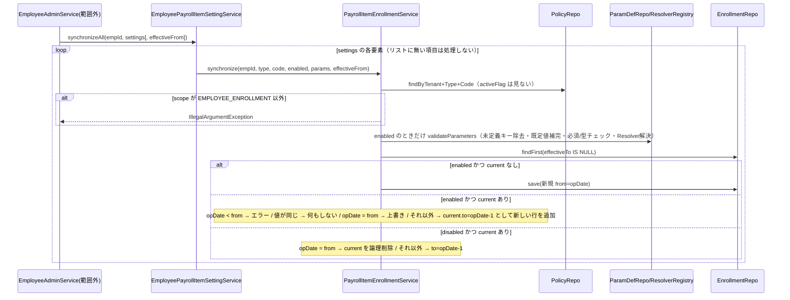
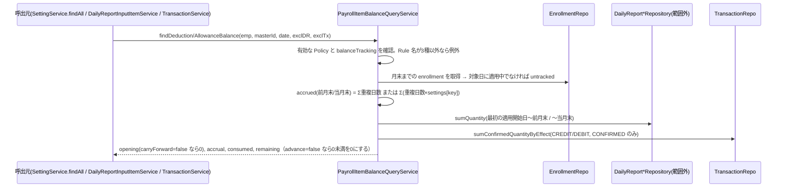
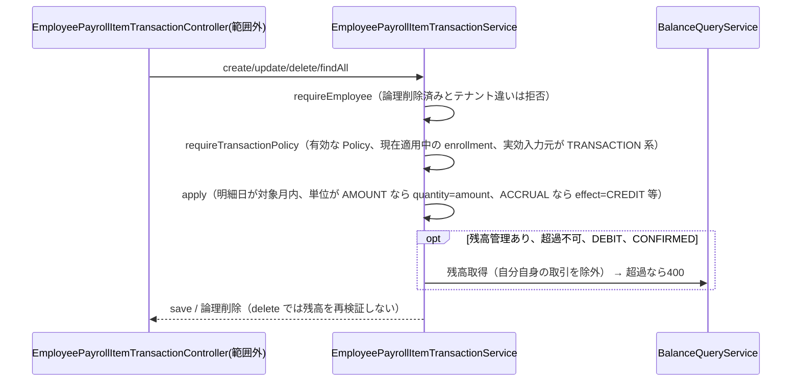
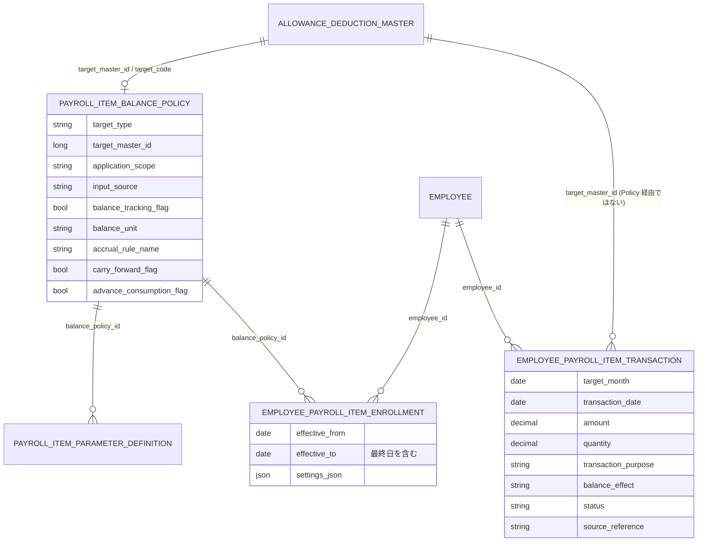

# payroll 解析結果
- 対象: `BE/payroll/`、`BE/master/payrollitem/`（balance / transaction / parameter / service / controller / dto / enums / exception / provider / validation）、`backend/src/main/resources/sql/payroll/`、`frontend/src/features/master/payrollitem/`
- 参照した仕様書: `docs/specs/deduction/allowance-deduction-policy-parameter-v1.md`、`docs/specs/deduction/deduction-field-usage-and-integration-v1.md`、`docs/specs/deduction/deduction-unused-and-unintegrated-v1.md`、`docs/specs/allowance/allowance-unused-and-unintegrated-v1.md`、`docs/kb/payroll-item-transaction-deduction-foundation.md`、`docs/kb/employee-dormitory-deduction-foundation.md`、`docs/kb/allowance-deduction-rule-v1-refactoring.md`（いずれも enrollment・残高・取引・パラメーターに関係する節だけ）
- 解析日: 2026-11-15（作業ツリー基準。HEAD f55af57）
- BE = `backend/src/main/java/com/project/backend/features`
- 解析方法: Claude Code の読み取り専用サブエージェントによる静的解析。範囲外モジュールは名前のみ記録し、未検証。
- 関連: [employee.md](employee.md)（§8 で持ち越し質問に回答）

## 1. 概要
- 手当・控除の共通基盤です。中心は次の4テーブルです。
  - `payroll_item_balance_policy`: 適用範囲、入力元、残高ルール
  - `payroll_item_parameter_definition`: 従業員別に入力するパラメーターの定義
  - `employee_payroll_item_enrollment`: 従業員別の適用履歴（有効期間と settings_json）
  - `employee_payroll_item_transaction`: 明細型の取引
- **残高は保存しません**。参照のたびに `PayrollItemBalanceQueryService` が次の式で計算します: 発生（暦日数、または暦日数×単価）＋CREDIT取引−日報で消化した数量−DEBIT取引。
- この範囲の REST エンドポイントは `GET /api/master/payroll-rule-options` だけです。従業員別設定と取引の API は employee 側のコントローラーから呼ばれます。
- `BE/payroll/`（PayrollItemType / Payslip / PayslipItem / SalaryRecord）は旧来の Entity です。backend 内に参照元がなく、未使用と判断しました。
- `sql/payroll/` 配下に allowance / deduction / payrollitem サブディレクトリは**存在しません**。SQL は `payroll_item_type_init.sql` 1本だけです。

## 2. 構成ファイル
| 層 | ファイル（BE/master/payrollitem/ 配下。別記以外） | 役割 |
|---|---|---|
| Controller | controller/PayrollRuleOptionController.java | Rule の選択肢一覧（`master:manage` 権限） |
| Advice | controller/PayrollItemMasterExceptionHandler.java | Allowance / Deduction / RuleOption の各 Controller について、例外を 400 / 404 / 409 に変換 |
| Service | balance/EmployeePayrollItemSettingService.java | 従業員別設定の取得・同期、日報向けのパラメーター解決と除外判定 |
| Service | balance/PayrollItemEnrollmentService.java | enrollment の履歴化（新規・更新・終了）とパラメーター検証 |
| Service | balance/PayrollItemBalanceQueryService.java | 残高スナップショットの計算（読み取り専用） |
| Service | balance/PayrollItemPolicyService.java | Policy と parameter definition の upsert・検証（手当・控除マスター保存時に呼ばれる） |
| Service | transaction/EmployeePayrollItemTransactionService.java | 取引の CRUD と、消化数量が残高を超えないかの検証 |
| Service | service/PayrollItemCalculationService.java, PayrollItemValueService.java, PayrollItemDailyInputService.java, PayrollItemQueryService.java, PayrollMoneyPolicy.java, PayrollRuleOptionService.java | 日報候補の計算、Rule 実行、金額の丸め、Rule の選択肢 |
| Validation | service/validation/PayrollItemMasterValidator.java | マスター共通の検証（allowance / deduction から利用） |
| Parameter | parameter/PayrollItemRuleParameterResolverRegistry.java, SelectOptionCalculationValueResolver.java, ...Context / ...ValueResolver | `SELECT_OPTION_CALCULATION_VALUE:{key}` を解決する SPI |
| Provider IF | provider/PayrollItemValueProvider.java | 実装は allowance / deduction 側（範囲外） |
| Entity | balance/PayrollItemBalancePolicy.java, PayrollItemParameterDefinition.java, EmployeePayrollItemEnrollment.java, transaction/EmployeePayrollItemTransaction.java | 4テーブル |
| Repository | balance/*Repository.java, transaction/EmployeePayrollItemTransactionRepository.java | Spring Data。合計の算出は native SQL |
| Enum | enums/PayrollItemInputSource（DAILY_REPORT / TRANSACTION / DAILY_REPORT_AND_TRANSACTION）, TargetType, QueryType, balance/BalanceUnit, ApplicationScope, ParameterInputType, transaction/BalanceEffect, Purpose, Source, Status | |
| Legacy | BE/payroll/entity/*.java, enums/*.java | 参照元なし |
| SQL | backend/src/main/resources/sql/payroll/payroll_item_type_init.sql | `payroll_item_types` の初期データ14件（寮費 DORMITORY は FIXED として登録） |
| FE | frontend/src/features/master/payrollitem/components/PayrollItemPolicyEditor.vue | Policy とパラメーター定義の編集UI（手当・控除の各フォームに埋め込み） |
| FE | .../api/usePayrollRuleOptionsQuery.ts, types/payrollItemPolicyTypes.ts, types/payrollRuleOptionTypes.ts, form/payrollItemFormFields.ts | API 呼び出し、型、計算設定フォームの項目定義 |

## 3. エンドポイント・画面
| Method | Path | Controller#method | 概要 |
|---|---|---|---|
| GET | /api/master/payroll-rule-options?targetType= | PayrollRuleOptionController#findActiveRules（controller/PayrollRuleOptionController.java:25-30） | 有効な RuleMaster のうち、`targetType` と GENERAL の Rule を名前順で返す（service/PayrollRuleOptionService.java:36-52） |
| GET/POST/PUT | `/api/employees`, `/api/employees/{id}`, `/api/employees/payroll-item-settings/catalog` | EmployeeAdminController → EmployeeAdminService → EmployeePayrollItemSettingService | 従業員別設定の取得・保存（パスは [employee.md](employee.md) §3 を参照） |
| GET/POST/PUT/DELETE | `/api/employees/{employeeId}/payroll-item-transactions[/{transactionId}]` | EmployeePayrollItemTransactionController → EmployeePayrollItemTransactionService | 従業員別取引の CRUD（パスは employee.md §3 を参照） |
| （範囲外） | 手当・控除マスターの保存・取得 | Allowance/DeductionCommandService・QueryService → PayrollItemPolicyService#synchronize / #find | 1-5b で解析予定 |

| フロント部品 | 呼び出す API | 利用元（範囲外。名前のみ） |
|---|---|---|
| usePayrollRuleOptionsQuery.ts:11-18 | GET /api/master/payroll-rule-options | AllowanceFormDialog.vue, DeductionFormDialog.vue 等 |
| PayrollItemPolicyEditor.vue（v-model で PayrollItemPolicy を編集） | 単独の API なし。手当・控除マスターの保存リクエストに含めて送信 | AllowancePage / DeductionPage, 各 FormDialog, 各 mapper |
| payrollItemFormFields.ts:11-17 | なし（ruleName / defaultAmount 等の項目定義） | allowance / deduction フォーム |

- PolicyEditor には `accrualRuleName` / `accrualFrequency` の入力欄がありません。値は単位を固定するかどうかの判定にだけ使われます（PayrollItemPolicyEditor.vue:10-24）。

## 4. 処理フロー
### 4.1 従業員別設定の同期（enrollment の履歴化）


### 4.2 残高の計算


### 4.3 取引の CRUD


## 5. DB操作
| テーブル | 操作 | 実装箇所 | 備考 |
|---|---|---|---|
| payroll_item_balance_policy | C/U | balance/PayrollItemPolicyService.java:43-64 | テナント+種別+コードで upsert。保存のたびに activeFlag=true, deletedAt=null を設定 |
| payroll_item_balance_policy | R | SettingService:47-54, EnrollmentService:64, BalanceQueryService:126, TransactionService:208 | |
| payroll_item_parameter_definition | C/U/D(論理) | PolicyService.java:86-123 | リクエストに無いキーは activeFlag=false と deletedAt を設定 |
| payroll_item_parameter_definition | R | SettingService:286,317,332, EnrollmentService:186, SelectOptionCalculationValueResolver.java:53 | |
| employee_payroll_item_enrollment | C | EnrollmentService.java:162-175 | tenantId を明示的に設定していない（BaseEntity 側の挙動は要確認） |
| employee_payroll_item_enrollment | U | EnrollmentService.java:130,134,159 | settings_json の上書き、effective_to の設定 |
| employee_payroll_item_enrollment | D(論理) | EnrollmentService.java:153-155 | 開始日と同じ日に終了したとき |
| employee_payroll_item_enrollment | R | SettingService:45,124,157,235, BalanceQueryService:151,260, TransactionService:218 | Repository に tenantId 条件がない（EmployeePayrollItemEnrollmentRepository.java:12-26） |
| employee_payroll_item_transaction | C/U | TransactionService.java:76-84, 103 | `@Version` で楽観ロック。一意制約は (tenant, emp, type, code, source_reference)（EmployeePayrollItemTransaction.java:25-31） |
| employee_payroll_item_transaction | D(論理) | TransactionService.java:113 | |
| employee_payroll_item_transaction | R | TransactionService:56, EmployeePayrollItemTransactionRepository.java:32-54（native SUM） | |
| daily_report_allowance / deduction | R | BalanceQueryService:240-245（範囲外 Repository の sumQuantity） | |
| rule_master | R | PayrollRuleOptionService.java:41 | |
| payroll_item_types | C(初期データ) | sql/payroll/payroll_item_type_init.sql:1-15 | Entity は PayrollItemType。参照元なし |
| payslips / payslip_items / salary_records | なし | BE/payroll/entity | 未使用 |



## 6. 依存関係
```mermaid
graph LR
  subgraph 範囲外の呼出元
    EAC[EmployeeAdminController/Service]
    ETC[EmployeePayrollItemTransactionController]
    DRI[DailyReportInputItemService]
    ADC[Allowance/Deduction Command・QueryService]
    DRC[DailyReport*CommandService / DailyPayComponentCalculationService]
    FE[AllowanceFormDialog / DeductionFormDialog]
  end
  EAC --> SS[EmployeePayrollItemSettingService]
  DRI --> SS
  DRI --> BQ[PayrollItemBalanceQueryService]
  DRI --> DIS[PayrollItemDailyInputService]
  ETC --> TS[EmployeePayrollItemTransactionService]
  ADC --> PS[PayrollItemPolicyService]
  DRC --> MP[PayrollMoneyPolicy]
  ADC --> MV[PayrollItemMasterValidator]
  SS --> ES[PayrollItemEnrollmentService]
  SS --> BQ
  SS --> RR[ResolverRegistry]
  ES --> RR
  TS --> BQ
  RR --> SOR[SelectOptionCalculationValueResolver]
  DIS --> CS[PayrollItemCalculationService] --> VS[PayrollItemValueService] --> RES[RuleExecutionService(範囲外)]
  CS --> QS[PayrollItemQueryService] --> PV[PayrollItemValueProvider impl: Allowance/Deduction(範囲外)]
  BQ --> DRR[DailyReportAllowance/DeductionRepository(範囲外)]
  SS & TS --> AMR[Allowance/DeductionMasterRepository(範囲外)]
  TS --> EMR[EmployeeRepository(範囲外)]
  FE --> RO[PayrollRuleOptionController] --> RM[RuleMasterRepository(範囲外)]
```

## 7. 既存仕様書との乖離
| 項目 | 仕様書の記述 | 実装 | 根拠 |
|---|---|---|---|
| carryForward | 「判定では未参照。常に繰越相当」（policy-parameter-v1.md:29、deduction-unused-v1.md:21、allowance-unused-v1.md:34） | **参照している**。false のとき opening=0 | BalanceQueryService.java:205-206 |
| advanceConsumption | 「判定では未参照。負数は0に丸める」（policy-parameter-v1.md:30、deduction-unused-v1.md:25、allowance-unused-v1.md:35） | **参照している**。true なら負の残高を保持し、false のときだけ0に丸める。取引の超過検証にも使う | BalanceQueryService.java:214-217; TransactionService.java:181-200 |
| 残高発生の方式 | 「CALENDAR_DAYS_IN_ENROLLMENT と MANUAL_TRANSACTION のみ」（policy-parameter-v1.md:28、deduction-field-usage-v1.md:62） | 3方式目 `CALENDAR_DAYS_TIMES_PARAMETER:{key}` を実装済み | BalanceQueryService.java:30-31,140-147,264-278; PolicyService.java:134-144 |
| 月初リセット | 「月初で残高をリセットしない」（transaction-foundation.md:134） | carryForward=false の場合はリセットする（同じ KB の :40 とも矛盾） | BalanceQueryService.java:205 |
| 入力元の切替キー | `parameters.inputSource`（dormitory KB:13）／`collectionMode=MONTHLY`（transaction KB:15,165） | 固定キーはない。`inputSourceOverrideFlag` が立った SELECT 項目の値を使う。collectionMode は範囲内に存在しない | SettingService.java:328-351; PolicyService.java:185-202 |
| 寮費の Resolver キー | `SELECT_OPTION_CALCULATION_VALUE:dormitoryType`（rule-v1-refactoring.md:273）、例は `roomType`（deduction-field-usage-v1.md:89-99） | 汎用 Resolver のため、キー名は設定データ次第 | SelectOptionCalculationValueResolver.java:25,48 |
| 消化の超過禁止 | 「日報入力時と保存時の両方で検証」（transaction KB:55） | 取引側は CONFIRMED かつ DEBIT のときだけ検証。DRAFT→CONFIRMED は update 経由で検証される。CREDIT 取引の削除で残高がマイナスになっても検証しない | TransactionService.java:107-114,175-186 |
| source_reference の重複防止 | 「指定時は重複を防止」（transaction KB:131） | 一意制約に deleted_at が含まれないため、論理削除した明細番号を再登録すると制約違反になる可能性がある | EmployeePayrollItemTransaction.java:22-31 |
| 修正する範囲 | 「enrollment は有効期間付きで保存」（deduction-field-usage-v1.md:113） | 有効期間は開始日以降へ進めることしかできず、過去に遡る修正はできない | EnrollmentService.java:119-123,147-151 |
| SQL の配置 | （_INDEX 上の想定）sql/payroll/{allowance,deduction,payrollitem} | 該当ディレクトリなし。DDL は sql/daily_report/payroll_item_*_foundation_v1.sql（範囲外） | `find` の結果 |

## 8. employee 解析からの持ち越し質問への回答
**Q1. synchronizeAll / findAll**
- **synchronizeAll** は、渡された settings の各要素について `PayrollItemEnrollmentService.synchronize` を呼ぶだけです（SettingService.java:248-263）。settings が null なら何もしません（:259）。
- **開始日（opDate）の決め方**: 引数 `effectiveFrom` を使い、未指定なら `LocalDate.now(clock)` にします（SettingService.java:250; EnrollmentService.java:80-82）。
- **更新時の動き**（EnrollmentService.java:112-141）:
  - opDate が現行行の開始日より前 → エラー
  - パラメーターの Map が同じ → 何もしない
  - opDate と開始日が同じ → settings_json を上書き
  - それ以外 → 現行行を `effective_to = opDate-1` で閉じ、opDate から始まる新しい行を INSERT
- **無効化（enabled=false）時の動き**（EnrollmentService.java:143-160）:
  - 開始日と同じ日 → 論理削除
  - それ以外 → `effective_to = opDate-1`
  - 無効化のときはパラメーター検証をしません（:83-86）。
- **リクエストから外れた設定**: 何も処理されません。enrollment はそのまま有効に残ります。終了させるには `enabled=false` を明示的に送る必要があります。
- **保存前の検証**: 未定義キーの除去、既定値の補完、必須チェック、型チェック、Resolver が出した値での上書き（EnrollmentService.java:177-225）。
- **範囲チェック**: 対象 Policy が EMPLOYEE_ENROLLMENT 以外なら例外です（:74-78）。Policy の activeFlag は確認していません（:64-67）。
- **findAll** は次の条件の Policy ごとに1件返します（SettingService.java:43-77）: 有効、EMPLOYEE_ENROLLMENT、対応するマスターが enabled。
  - `enabled` = `effectiveTo` が null の行があるか。
  - 期間と settings は、その行（無ければ最後の行）の値。
  - 残高は「今日」時点で計算。
  - settings には既定値を補完。

**Q2. 論理削除された従業員の扱い**
- 取引の CRUD と一覧は、すべて `requireEmployee` で論理削除済みとテナント違いを拒否します（TransactionService.java:54,71,93,109,292-302）。
- enrollment 側（SettingService.findAll / synchronizeAll / findDailyRuleParameters / isDailyReportInputEnabled、BalanceQueryService）は、従業員の存在も削除状態も確認していません。Repository も `employeeId` だけで検索します（EmployeePayrollItemEnrollmentRepository.java:12-26）。
- この範囲には、従業員を削除したときに enrollment や取引を終了・削除する処理はありません。月次 View（`monthly_pay_slip_view_foundation_v1.sql`、範囲外）が削除済み従業員を除外しているかは未確認です。

**Q3. 寮費のモデル**
- この範囲の Java で実装されているのは、汎用の残高発生方式 `CALENDAR_DAYS_TIMES_PARAMETER:{key}` です。計算は Σ(重複する暦日数 × enrollment.settings_json[key]) です（BalanceQueryService.java:264-278,286-317）。
  - 単価は従業員が選んだ SELECT 値から `SELECT_OPTION_CALCULATION_VALUE:{sourceKey}` が `calculationValue` を解決し、enrollment 保存時に settings_json へ書き込みます（EnrollmentService.java:208-223; SelectOptionCalculationValueResolver.java:36-90）。
  - この方式を選ぶと残高単位は AMOUNT に固定されます（PolicyService.java:134-144; PolicyEditor.vue:10-24）。
- `dormitory_fee_setting` テーブルに対応する Entity や Repository は、この範囲に**ありません**。名前が出てくるのは範囲外の SQL（`sql/employee/dormitory_foundation_v1.sql`、`sql/daily_report/payroll_item_balance_foundation_v1.sql`）だけです。
- Rule `DORMITORY_DAILY_FEE` も、この範囲の Java には出てきません（範囲外の `dormitory_foundation_v1.sql` にだけ存在）。日報の控除額はマスターの ruleName で決まる Rule が計算します。ruleParameter=true のパラメーターは `findDailyRuleParameters` で Rule に渡ります（SettingService.java:138-207; PayrollItemValueService.java:163-182）。そのため、日報の金額計算に「日額×数量」型の Rule を使い、残高の発生には暦日×単価を使う、という二つが**併存しうる**構成です。KB では、日報には実際に徴収した額を MANUAL で入力するとしています。
- **結論**: 残高モデルとして実装されているのは CALENDAR_DAYS_TIMES_PARAMETER です。DORMITORY_DAILY_FEE Rule と dormitory_fee_setting は、範囲外の SQL にしか存在しない旧資産の可能性が高いと考えます。確定には範囲外 SQL の確認が必要です。

**Q4. 残高の発生・消込と呼出元**
- 残高を保存するテーブルもバッチもありません。参照のたびに計算します（BalanceQueryService.java:114-228）。
- **発生**: 暦日数、暦日数×単価、または MANUAL_TRANSACTION（自動発生は0）に、CONFIRMED の CREDIT 取引（BALANCE_ACCRUAL は強制的に CREDIT）を加えたものです。
- **消込**: 日報明細の quantity 合計に、CONFIRMED の DEBIT 取引を加えたものです。
- 集計の起点は、その従業員の最も古い `effective_from` です（:162-165）。
- **呼出元**:
  - `DailyReportInputItemService`（範囲外。日報候補の表示や検証と推定）
  - `EmployeePayrollItemSettingService.findAll`（従業員画面の表示）
  - `EmployeePayrollItemTransactionService.validateConfirmedConsumption`
- 月次締めからの Java 呼び出しはありません。月次 View は取引テーブルを直接集計します（範囲外 SQL）。
- **DRAFT 取引の扱い**: 残高計算から除外されます（Repository.java:40）。

## 9. 未解決の疑問・要確認事項
1. enrollment と取引の INSERT 時に tenantId を明示していません。BaseEntity（範囲外）が自動で埋めるのかを確認する必要があります（EnrollmentService.java:168-174; TransactionService.java:76-84）。enrollment の参照もテナント条件がありません。
2. 一度終了した enrollment を、`effectiveFrom` を過去日にして再度有効化すると、閉じた行と期間が重なる可能性があります。閉じた行との重複チェックがないためです（EnrollmentService.java:87-98）。employee 側がどちらの overload（effectiveFrom を指定するか）を呼んでいるかも未確認です。
3. 残高の起点は「最も古い適用開始日」です。適用されていない空白期間の日報消化や取引も集計対象になり、再適用後に古い残高が引き継がれます（BalanceQueryService.java:162-199）。これが意図した仕様か確認が必要です。
4. enrollment が終了している（`effectiveTo` が設定済み）と、過去月の取引の更新や削除もできません（TransactionService.java:218-224, 101）。取引日が適用期間内かどうかも検証していません。
5. 新規作成では quantity=0 の DEBIT が通ります（0.00 以上なら可）。BALANCE_ACCRUAL の取引で残高単位が AMOUNT 以外の場合、quantity と amount の関係は利用者任せです（TransactionService.java:135-147）。
6. Policy の `findByTenant+Type+MasterId+ActiveFlagTrue` について、同じマスターに有効な Policy が複数あるケースは一意制約（tenant, type, code）でしか防いでいません。target_master_id での重複は想定外です（PayrollItemBalancePolicy.java:20-26）。
7. `BE/payroll` の Entity 群に参照元がありません。PayrollItemType と PayslipItem には getter がなく、Payslip.items は PayslipItem と双方向で定義されています。削除してよいか判断が必要です。
8. `PayrollItemMasterValidator` と `PayrollItemCalculationService` / `PayrollItemValueService` の詳細はマスター CRUD・日報計算の領域なので、今回は概要を読んだだけです。後続の解析（1-5b、1-3）で確認する。
