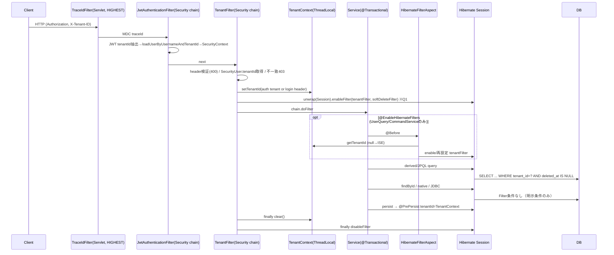

# tenant-boundary 解析結果
- 対象: テナント分離の仕組み（TenantContext / TenantFilter / BaseEntity / Hibernate Filter / Aspect / SecurityConfig）
- 参照仕様書: `docs/kb/tenant-boundary-v1.md`
- 解析日: 2026-11-15（作業ツリー基準。SecurityConfig には未コミット差分あり: `/auth/logout` を permitAll に追加）
- 解析方法: Claude Code の読み取り専用サブエージェントによる静的解析。カバレッジ（§8）だけは、アノテーション名・継承を限定 grep して件数を数えた。**実行時の挙動は未検証**。
- BE = `backend/src/main/java/com/project/backend`
- 関連: [employee.md](employee.md)、[payroll.md](payroll.md)、[daily-report.md](daily-report.md)、[monthly-closing.md](monthly-closing.md)（§7 で各解析の未確認点を検証）

## 1. 概要
- テナントIDはThreadLocalの `TenantContext` に入れる。認証後は `SecurityUser.tenantId`（JWTから再取得した値）、ログイン時だけ `X-Tenant-ID` ヘッダーを使う（`BE/app/tenant/filter/TenantFilter.java:51-89`）。
- SELECT の分離は `BaseEntity`（@MappedSuperclass）に付けた Hibernate `@FilterDef/@Filter("tenantFilter")` で行う。有効化するのは TenantFilter（リクエスト単位）と `@EnableHibernateFilters` Aspect の2か所。Aspect を付けているのは User 系の2サービスだけ。
- INSERT 時は `@PrePersist` で、tenantId が null なら TenantContext から補完する。
- `findById`、native SQL、JdbcTemplate、`REQUIRES_NEW` の新しいセッション、リクエスト外スレッドには Hibernate Filter が効かない。これらはリポジトリ側で明示的に tenantId を条件に入れる必要がある。
- **最重要の要確認点**: TenantFilter で `entityManager.unwrap(Session.class)` を呼ぶ時点では、トランザクションにも OSIV にも束縛された EntityManager がない。静的に見る限り、Filter の有効化は失敗するか、有効にならない可能性がある（§9-Q1）。

## 2. 構成ファイル
| ファイル | 役割 | 要点 |
|---|---|---|
| `BE/app/tenant/context/TenantContext.java:5-17` | テナント保持 | `ThreadLocal<String>`。set/get/clear(remove) だけ |
| `BE/app/tenant/filter/TenantFilter.java` | テナント確定とHibernate Filter有効化 | ヘッダー検証 :42-49、認証テナントとの照合 :60-74、ログイン時はヘッダー採用 :76-89、未認証なら素通し :91、finally で clear と filter 無効化 :106-112 |
| `BE/app/base/entity/BaseEntity.java` | 全テナントEntityの基底 | `@FilterDef/@Filter tenantFilter`（`tenant_id = :tenantId`）:21-28、softDeleteFilter :29-35、`tenant_id` NOT NULL（updatable 指定なし）:47-48、prePersist/preUpdate での補完 :50-67 |
| `BE/app/persistence/HibernateFilterAspect.java:25-53` | Filter再有効化 | `@within`/`@annotation(EnableHibernateFilters)` に対する @Before。TenantContext が空なら IllegalStateException |
| `BE/app/persistence/EnableHibernateFilters.java:8-10` | マーカー注釈 | TYPE/METHOD 対象 |
| `BE/app/persistence/HibernateFilterEnabler.java:17-29` | 手動で有効化する部品 | **どこからも呼ばれていない**（参照は定義ファイルだけ） |
| `BE/app/config/SecurityConfig.java:58-59,64-82` | フィルター登録 | `addFilterBefore(jwtFilter, UPAF)`、`addFilterAfter(tenantFilter, JwtAuthenticationFilter)`。Servlet側登録は `setEnabled(false)`（:70,:80） |
| `BE/app/config/WebConfig.java:16-27` | CORSだけ | Tenant関連の処理はない |
| `BE/app/security/jwt/filter/JwtAuthenticationFilter.java:54-81,108-112` | JWT認証 | JWTの tenantId 必須（:54-58）、`loadUserByUsernameAndTenantId`（:64）、TenantContext は設定しない。`/auth/login`・`/refresh`・`/logout` では処理をスキップ |
| `BE/common/filter/TraceIdFilter.java:20-64` | MDC traceId | 通常の Servlet Filter（HIGHEST_PRECEDENCE）。Security chain より外側で動く。MDC に tenantId は入れない |

## 3. リクエストからDBまでの処理フロー


## 4. 保護範囲マトリクス
| アクセス方式 | 保護 | 根拠 |
|---|---|---|
| derived query / JPQL `@Query`（BaseEntity継承Entity） | 条件付き | Hibernate `@Filter` は HQL/Criteria に効く（`BaseEntity.java:25-28`）。ただし同じ Session で Filter が有効になっている場合に限る（TenantFilter :100-104 または Aspect）。§9-Q1/Q2 |
| native query（`nativeQuery=true`） | 保護されない（明示条件があれば保護） | Hibernate Filter は native SQL には適用されない。対象は6ファイル（`dailyreport/.../DailyReportAllowanceRepository`、`DailyReportDeductionRepository`、`user/.../UserRepository`、`system/mail/.../MailRecipientGroupRepository`、`EmployeePayrollItemTransactionRepository`、`app/security/permission/.../RoleRepository`） |
| `findById` / `EntityManager.find` / `getReferenceById` | 保護されない | Filter は主キー直接ロードに効かない。`@FilterDef` に `applyToLoadByKey` の指定がない（`BaseEntity.java:21-24`） |
| JdbcTemplate SQL | 保護されない（明示条件のみ） | Hibernate の外側を通る。18ファイル（例: `features/system/report/service/api/ReportSqlExecutorService.java`、`app/sql/service/DynamicTableInsertService.java`、`features/system/backup/service/fetcher/BackupDataFetcher.java`） |
| INSERT（persist） | 条件付き | `BaseEntity.java:50-58`。tenantId が null の場合だけ TenantContext から補完する。TenantContext が空なら null のまま → NOT NULL 違反（fail-closed、DB制約に依存）。`@Setter` があるため、コード側で任意のテナントを明示設定できる |
| UPDATE（merge/dirty checking） | 保護されない | UPDATE は `WHERE id=?` だけ。preUpdate は null 補完だけ（:60-67）。`tenant_id` は updatable=false ではないので、setTenantId で書き換えもできる |
| DELETE（エンティティ単位 / 派生 `deleteBy...`） | 条件付き | 派生 deleteBy は先に SELECT する（Filter 対象）が、`deleteById` は findById 経由なので非保護 |
| `@Transactional(REQUIRES_NEW)` | 保護されない（Filterなし） | 新しい Session には TenantFilter が有効化した Filter が引き継がれない。Aspect を付けていなければ無効（例: `MonthlyClosingExecutionStateService.java:36,98,121,142`） |
| async / batch / scheduler / 起動時runner | 条件付き | TenantContext は set/clear している（`BatchDynamicSchedulerService.java:158-162`、`NoticeDynamicSchedulerService.java:158`、`AnnualReportBackupStartupRunner.java:22,57`）が、Hibernate Filter は有効化しない。明示的な tenantId 条件だけが頼り。`@Async`/`@Scheduled` は0件、TaskDecorator もない |
| `InitConfig`（起動時シード） | 要注意 | `BE/app/config/InitConfig.java:89` で `setTenantId("default")` した後に clear しているか未確認（起動スレッドへの残留） |

## 5. 依存関係
```mermaid
graph TD
    SC[SecurityConfig] -->|addFilterBefore| JWT[JwtAuthenticationFilter]
    SC -->|addFilterAfter JWT| TF[TenantFilter]
    SC -->|setEnabled false| REG[FilterRegistrationBean x2]
    JWT --> UDS[CustomUserDetailsService.loadUserByUsernameAndTenantId]
    JWT --> SCH[SecurityContextHolder]
    TF --> SCH
    TF --> TC[TenantContext]
    TF --> EM[EntityManager shared proxy]
    EM --> HS[Hibernate Session]
    BE[BaseEntity @FilterDef/@Filter/@PrePersist] --> TC
    ASP[HibernateFilterAspect] --> TC
    ASP --> EM
    ANN[@EnableHibernateFilters] -.pointcut.-> ASP
    UQS[UserQueryService/UserCommandService] -.annotated.-> ANN
    HFE[HibernateFilterEnabler 未使用] --> TC
    RUN[AnnualReportBackupStartupRunner / Batch・NoticeScheduler / InitConfig] --> TC
    ENT[95 Entities] -->|extends| BE
    TRACE[TraceIdFilter Servlet] -.独立.-> MDC[MDC]
```

## 6. 既存仕様書との乖離
| # | 仕様書 | 実装 | 評価 |
|---|---|---|---|
| D1 | §6「Tenant確定後、TenantFilterが tenantFilter/softDeleteFilter を有効化」 | コード上はそのとおり（:100-104）。ただし実行時点で Session が束縛されていない可能性がある（Q1）。単体テストは EM/Session をモックしている（`backend/src/test/.../TenantFilterTest.java:38-43`） | 実効性が未検証 |
| D2 | 記載なし | Hibernate Filter は findById、native、JDBC、REQUIRES_NEW、リクエスト外スレッドに効かない | 仕様書に保護範囲の記載がない |
| D3 | 記載なし | `@EnableHibernateFilters` を付けているのは `features/user/service/UserQueryService.java` と `UserCommandService.java` の2クラスだけ。`HibernateFilterEnabler` は未使用 | 二重機構のうち片方が死蔵 |
| D4 | §3.3 未認証APIではTenantContextを設定しない | :91 で素通しする。一致 | 一致 |
| D5 | §4 JWT→Tenant→UPAF の順序 | `SecurityConfig.java:58-59`。一致 | 一致 |
| D6 | §5 Servlet二重登録の防止 | `SecurityConfig.java:64-82` で setEnabled(false)。一致 | 一致 |
| D7 | 記載なし | `/auth/refresh` と `/auth/logout`（未コミット差分で permitAll に追加）は JWT をスキップし、ログイン扱いでもないため TenantContext が空のまま | 仕様が未定義。refresh/logout 側のテナント解決は要確認 |
| D8 | §2「JWT Filter が TenantContext を設定」は旧挙動 | 現在の JwtAuthenticationFilter は TenantContext に触れない | 一致（解消済み） |
| D9 | 記載なし | INSERT の自動補完（prePersist）と UPDATE の非保護 | 仕様書に記載がない |

## 7. 過去解析の検証結果
| 対象 | 判定 | 理由 | 根拠 |
|---|---|---|---|
| V1 EmployeePayrollItemEnrollment 派生クエリ | 条件付き | BaseEntity を継承しているので Filter の対象。ただしサービスに `@EnableHibernateFilters` がなく、TenantFilter が有効化した Filter だけが頼り（Q1）。findAllBy... 3件はいずれも tenantId を引数に持たない | `features/master/payrollitem/balance/EmployeePayrollItemEnrollment.java:20`、`EmployeePayrollItemEnrollmentRepository.java:8-22` |
| V1 saveEnrollment INSERT | 保護される（条件付き） | tenantId は未設定なので prePersist が TenantContext から補完する。HTTP経由なら認証テナントが入る。Context が空なら NOT NULL 違反で失敗（fail-closed） | `PayrollItemEnrollmentService.java:162-175`、`BaseEntity.java:50-58` |
| V2 sumConfirmedQuantityByEffect（native） | 保護される | SQL に `item.tenant_id = :tenantId` が明示されており、呼び出し元は `TenantContext.getTenantId()` を渡す。null なら0件（合計0）。fail-closed だがエラーにならない | `EmployeePayrollItemTransactionRepository.java:32-54`、`PayrollItemBalanceQueryService.java:332-333` |
| V3 DailyReportAllowance/Deduction sumQuantity（native） | 保護される | item 側と report 側の両方に tenant_id 条件がある。tenantId は呼び出し元で TenantContext から取得 | `DailyReportAllowanceRepository.java:13-32`、`DailyReportDeductionRepository.java:13-32`、`PayrollItemBalanceQueryService.java:176,240-245` |
| V3 補足 findByDailyReportId / deleteByDailyReportId | 条件付き | 派生クエリなので Filter 頼み | 同ファイル :9,:11 |
| V4 findById（ExecutionState:203,210 / Command:100） | 保護されない（実害は条件付き） | 主キーロードは Filter 対象外。加えて ExecutionStateService は REQUIRES_NEW で新しい Session を使う。ID はサーバー内部のフローで得たもの（findOrCreate、startNew）で、外部入力ではないため、直ちに越境する経路は確認できない | `MonthlyClosingExecutionStateService.java:36,203,210`、`MonthlyClosingCommandService.java:100,111-112` |
| V5 MonthlyClosingRepository / CustomerBillingClosingRepository 派生クエリ | 条件付き | tenantId 引数がなく、Filter 頼み。Filter が効かない場合、`findByTargetMonthAndDeletedAtIsNull` は他テナントの行を返すか、複数テナントがあると IncorrectResultSize になる（DBの unique は `(tenant_id,target_month)`） | `MonthlyClosingRepository.java:8,10`、`CustomerBillingClosingRepository.java:9-24`、`entity/MonthlyClosing.java:17,22` |
| V6 AnnualReportBackupStartupRunner | 保護される（条件付き） | 設定ごとに `TenantContext.setTenantId` し、finally で clear する。設定一覧の取得（:19-20）は意図的に全テナント対象。Hibernate Filter は無効だが、`AnnualReportBackupService` は `requireTenantId()` で取った値を全クエリに明示的に渡している。その先の下流呼び出しは未検証 | `AnnualReportBackupStartupRunner.java:19-22,56-57`、`AnnualReportBackupService.java:55,105,358-363` |
| V7 Employee / EmployeeRepository | 条件付き | Employee 自身には `@Filter` がないが、BaseEntity（@MappedSuperclass）から継承する。リポジトリの4メソッドはすべて tenantId なしで Filter 頼み。`findByIdAndDeletedAtIsNull` は派生クエリなので Filter は効く（findById とは異なる）。Filter が効かない場合、`existsByEmployeeCode...` は他テナントのコードと重複判定する（誤検知） | `features/employee/entity/Employee.java:16-24`、`repository/EmployeeRepository.java:8-14` |

## 8. カバレッジ
- `@Filter(`/`@FilterDef(` を持つファイル（BE/features 配下）: **0件**。定義は `BaseEntity` の1か所だけ。
- `@Entity`（features+app）: 103件。そのうち `extends BaseEntity`: **95件**。Filter の対象はこの95件で、継承によって付与される。
- BaseEntity を継承しない @Entity（Filter の対象外 = 漏れ候補）:
  - `features/tax/entity/InsuranceRate.java`、`StandardSalary.java`、`IncomeTaxBracket.java`（法定マスタなので共通データとみられる。要確認）
  - `app/security/jwt/entity/RefreshToken.java`
  - `app/security/permission/entity/Role.java`、`Permission.java`
  - `app/job/entity/AsyncJob.java`
  - `app/feature_flag/entity/FeatureFlag.java`
- Filter が効かない経路: native クエリ6ファイル、JdbcTemplate 18ファイル（§4参照）。これらは個別に tenant_id 条件の有無を監査する必要がある。
- `@EnableHibernateFilters` の付与: 2クラスだけ（User系）。

## 9. 未解決の疑問・要確認事項
- **Q1（高）**: TenantFilter は Security chain 内（DispatcherServlet より前）で動く。この時点では OSIV（`spring.jpa.open-in-view` 未設定なのでデフォルト true。Interceptor 方式）も @Transactional も EntityManager を束縛していない。共有 EM プロキシの `unwrap(Session.class)` は Spring 6 の SharedEntityManagerCreator で「No transactional EntityManager available」になるか、一時的な Session に対する有効化になる可能性がある。実環境で以下を確認する必要がある。(a) 例外にならないか、(b) 後続クエリの SQL に `tenant_id=?` が付くか。単体テストはモックなので、これは検証できていない（`TenantFilterTest.java:38-43`）。Spring Boot 3.5.11（`backend/build.gradle:3`）。
  - 補足（メインセッションの推論。コードでは未確認）: SharedEntityManagerCreator は、トランザクションに束縛された EM がないとき、`unwrap` 呼び出し用に一時的な EM を作り、呼び出しの後に閉じる実装と理解している。そうであれば、TenantFilter が有効化した Filter は直後に破棄され、後続クエリには効かない。その場合に実際に分離が効いているのは `@EnableHibernateFilters` を付けた User 系2サービスと、tenant_id を明示した native/JDBC クエリだけになる。**実環境で SQL ログ（`spring.jpa.show-sql` 等）を見て確認することを強く推奨**。
- Q2: Filter を有効化した Session と、OSIV や @Transactional が使う Session が同じか。REQUIRES_NEW の境界（月次締めなど）では確実に別 Session になる。
- Q3: HibernateFilterAspect（@Before）と TransactionInterceptor の実行順序。どちらにも @Order がない。Aspect が Tx 開始前に動くと、OSIV がない文脈では Q1 と同じ問題が起きる。
- Q4: `HibernateFilterEnabler` が未使用なのは意図したものか。`@EnableHibernateFilters` を全サービスへ展開する計画はあるか。
- Q5: HQL の一括 UPDATE/DELETE（`@Modifying @Query`）に Hibernate 6 の Filter が適用されるか。対象リポジトリの棚卸しは範囲外。
- Q6: `/auth/refresh`・`/auth/logout` では TenantContext が空になる。RefreshToken（非BaseEntity）の検索がテナントを考慮しているか。→ 0-1 auth-security で確認。
- Q7: `InitConfig.java:89` の `TenantContext.setTenantId("default")` の後に clear() しているか。起動スレッドへの残留リスク。
- Q8: `tenant_id` に `updatable=false` がない。コードで setTenantId を呼べばテナントの付け替えが可能。
- Q9: JdbcTemplate 18ファイルと native 6ファイルのうち、tenant_id 条件を明示していないものの監査（本解析で確認したのは V2/V3 だけ）。
- Q10: TraceIdFilter / MDC に tenantId がない。監査ログで追跡できるか。
